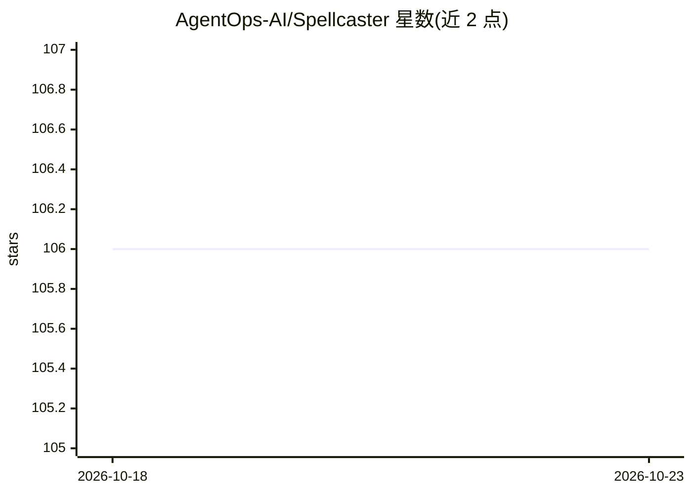

# AgentOps-AI/Spellcaster

⭐ 106 · Python · MIT · 推送 2025-11-24 · [GitHub](https://github.com/AgentOps-AI/Spellcaster) · 组织维护

**面向开发者文档的 AI 拼写与语法检查 CLI 工具**

开源 Python CLI 工具，扫描仓库中的文档文件（默认 .md/.mdx 等）检测语法错误、拼写问题与代码示例问题，并输出修复建议。支持指定本地目录或克隆 GitHub 仓库扫描，可选择 claude/gpt4o/gpt4/groq 等多种 LLM 提供商，通过 config.py 定制文件类型与扫描上限（默认 500 个文件）。依赖各 LLM 服务的 API key 环境变量，并使用 AgentOps 做成本与延迟追踪。Python 3.10+，pip 安装，MIT 许可。

## 筛选速览

| 维度 | 判定 | 备注 |
|---|---|---|
| AI 角色 | `ai-native` | 本体是模型或模型工具 |
| 许可风险 | `permissive` | MIT |
| 部署形态 | `library` | 以包/库形式分发 |
| 模型依赖 | locked-api |  |
| 硬件要求 | — | 无带数字的原话,不猜 |
| 安装摩擦 | `low` | 无编译、无系统依赖或容器化 |
| 成熟度 | — | 结构信号不足 |

## 能力要点

- 扫描 Markdown/纯文本等多种格式，检测语法、拼写与代码示例问题
- 支持本地目录与 GitHub 仓库 URL 两种扫描方式
- 可选多种 LLM 提供商（claude、gpt4o、gpt4 等）
- config.py 可定制扫描文件类型与最大文件数（默认 500）

## 适用场景

- 我需要在发布文档前批量检查拼写和语法错误
- 我想扫描整个 GitHub 仓库的 Markdown 文档并获取修复建议
- 我想换不同的 LLM 提供商来做文档检查

## 场景标签

`AI 写作` · 领域:内容生成

## 证据(README 行号)

> L14: Spellcaster is an open-source CLI tool that uses AI to improve your codebase's documentation. It scans repositories
> L34: * Grammar and Spelling Checks: Spellcaster reviews your documentation and comments to ensure they are clear, correc

## 星数曲线

2026-10-18 106 → 2026-10-23 106（+0）

---
*卡片 v1 · prompt 1.4 · 生成 2026-10-23 · 置信度 high · 依据 README sha `6bd0d770dee2` · [字段定义](../../DATASET.md)*
