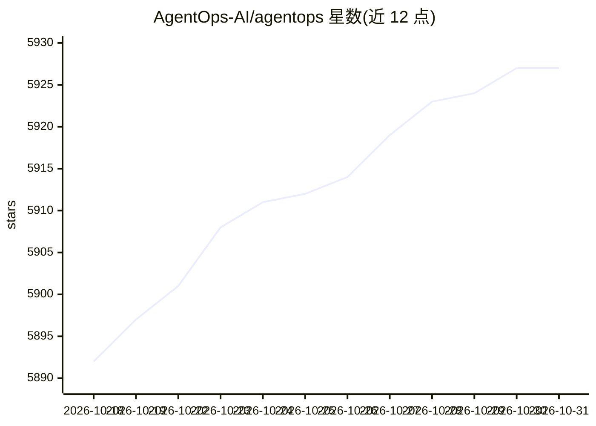

# AgentOps-AI/agentops

⭐ 5,927 · Python · MIT · 推送 2026-06-25 · [GitHub](https://github.com/AgentOps-AI/agentops) · [官网](https://agentops.ai) · 组织维护

**AI Agent 可观测性与监控平台：会话回放、成本追踪、评测**

面向开发者的 AI agent 观测与 DevTool 平台，提供 Python SDK（JS/TS 处于 Alpha）。通过初始化客户端或装饰器（session/agent/operation/task/workflow span）记录 LLM 调用，在 Dashboard 上提供会话回放、事件图、成本管理、自定义评测指标与提示注入检测等功能。与 CrewAI、AG2(AutoGen)、OpenAI Agents SDK、LangChain、CamelAI、Cohere、Anthropic、Mistral、LiteLLM、LlamaIndex、Llama Stack、SwarmZero 等框架原生集成；支持自有云自托管（Dashboard + API 后端），代码以 MIT 许可开源。使用需 AgentOps API key（自托管场景除外）。

## 筛选速览

| 维度 | 判定 | 备注 |
|---|---|---|
| AI 角色 | `ai-ecosystem` | LLM/agent 周边工具 |
| 许可风险 | `permissive` | MIT |
| 部署形态 | `library` | 以包/库形式分发 |
| 模型依赖 | locked-api |  |
| 硬件要求 | — | 无带数字的原话,不猜 |
| 安装摩擦 | `low` | 无编译、无系统依赖或容器化 |
| 成熟度 | `idea` | |

## 能力要点

- 两行代码接入即可自动采集 LLM 调用分析
- session/agent/operation/task/workflow 五类 span 装饰器，支持异步与生成器函数
- Dashboard 提供会话回放、事件图、成本追踪与跨会话指标
- 十余个框架原生集成（CrewAI、AG2、LangChain、Cohere、Anthropic、Mistral、LiteLLM 等）

## 适用场景

- 监控多 agent 应用的执行过程与失败点
- 追踪 LLM 与 API 调用成本
- 回放 agent 会话做调试与评测
- 在企业自有云上自托管 Dashboard 与 API 后端

## 场景标签

`LLM 可观测性` `模型评测` · 领域:评测与运维

## 证据(README 行号)

> L39: AgentOps helps developers build, evaluate, and monitor AI agents. From prototype to production.
> L60: |💸 **LLM Cost Management**|Track spend with LLM foundation model providers|

## 星数曲线

2026-10-18 5,892 → 2026-10-31 5,927（+35）

---
*卡片 v1 · prompt 1.4 · 生成 2026-10-20 · 置信度 high · 依据 README sha `e8b9b2558cea` · [字段定义](../../DATASET.md)*
