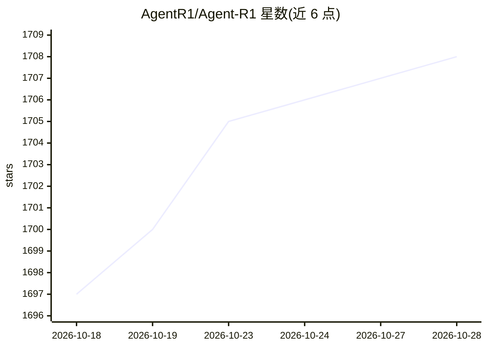

# AgentR1/Agent-R1

⭐ 1,708 · Python · MIT · 推送 2026-10-26 · [GitHub](https://github.com/AgentR1/Agent-R1) · 组织维护 · 中文 README

**训练多步 LLM agent 的端到端强化学习框架**

基于 verl 的模块化 Agentic RL 训练框架，将每轮交互建模为 step 级 MDP 转移：模型观察环境、生成动作、接收工具/环境反馈，循环至任务完成。提供分层抽象（AgentFlowBase/AgentEnvLoop/AgentEnv/ToolEnv/BaseTool），新任务可复用同一训练器，支持 GRPO、PPO、REINFORCE、RLOO、StepPO、过程奖励与多模态 agent。当前版本要求 verl==0.7.0，通过克隆仓库使用，含 GSM8K、HotpotQA、ALFWorld、WebShop 等 recipe，工作于中国科大认知智能全国重点实验室。

## 筛选速览

| 维度 | 判定 | 备注 |
|---|---|---|
| AI 角色 | `ai-ecosystem` | LLM/agent 周边工具 |
| 许可风险 | `permissive` | MIT |
| 部署形态 | `library` | 以包/库形式分发 |
| 模型依赖 | — | README 未给出锁定关系 |
| 硬件要求 | — | 无带数字的原话,不猜 |
| 安装摩擦 | `low` | 无编译、无系统依赖或容器化 |
| 成熟度 | — | 结构信号不足 |

## 能力要点

- step 级 MDP 轨迹表示，显式管理工具调用、环境状态与奖励分配
- 分层抽象使新任务无需重写 RL 栈即可接入同一训练器
- 支持 GRPO/PPO/REINFORCE/RLOO/StepPO 与逐工具调用的过程奖励
- 提供 GSM8K、HotpotQA、ALFWorld、WebShop、论文检索等任务 recipe 与处理后数据

## 适用场景

- 对多步工具调用 LLM agent 做端到端 RL 训练
- 在新任务环境上复用现成训练器做 agentic RL 实验
- 复现 Qwen3-4B 在 agent 场景下的 RL 训练结果
- 为自定义环境与工具实现 step 级信用分配

## 场景标签

`强化学习` · 领域:训练与推理

## 证据(README 行号)

> L11: **Agent-R1** is a unified, modular framework for **Agentic Reinforcement Learning**. It trains multi-step LLM agent
> L75: Agent-R1 uses the same environment setup as verl, and the current version requires `verl==0.7.0`. You only need to 

## 星数曲线

2026-10-18 1,697 → 2026-10-28 1,708（+11）

---
*卡片 v1 · prompt 1.4 · 生成 2026-10-21 · 置信度 mid · 依据 README sha `c5ff032b9583` · [字段定义](../../DATASET.md)*
