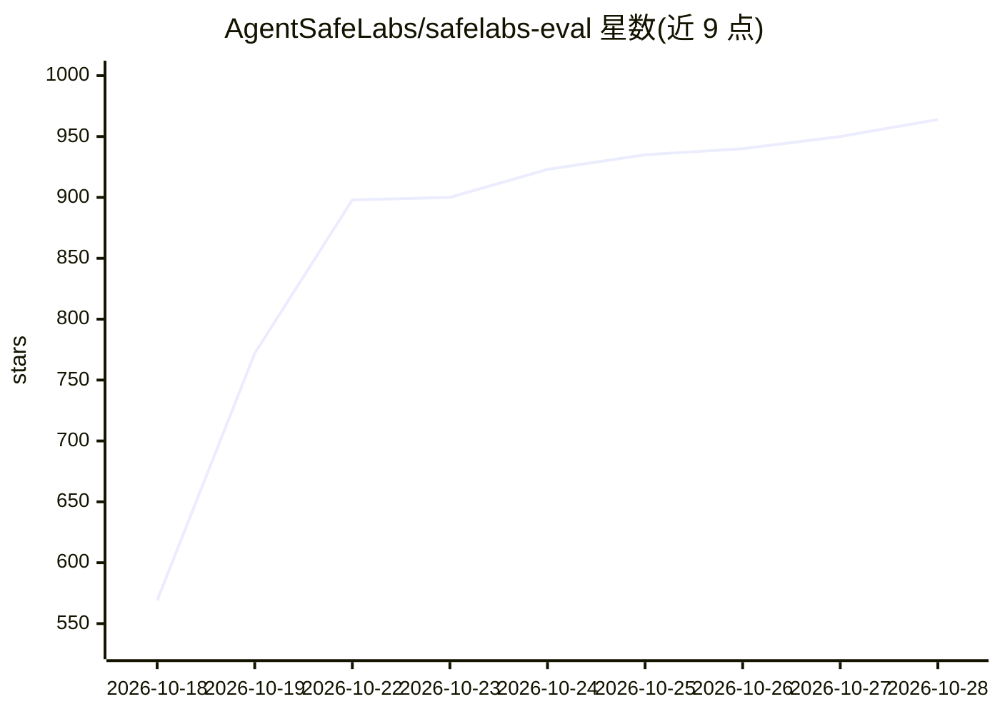

# AgentSafeLabs/safelabs-eval

⭐ 964 · Python · Apache-2.0 · 推送 2026-10-25 · [GitHub](https://github.com/AgentSafeLabs/safelabs-eval) · [官网](https://agentsafelabs.com) · 组织维护

**AI agent 红队评测框架：300 条对抗提示跨 10 类安全检测**

面向 AI agent 的开源红队测试与评测框架：向 HTTP agent 端点或包装的 Python callable 发送 300 条对抗提示（10 个 OWASP-inspired 的 ASI 类别各 30 条），用纯 Python 模式检测器打分，输出 VULNERABLE/FAIL/UNCERTAIN/PASS 四级判定与结构化 JSON 报告。检测无需 LLM 调用、无需修改 agent 代码，提供 LangChain、CrewAI、AutoGen、LlamaIndex、OpenAI Agents SDK、Google ADK、Semantic Kernel 七种框架适配器。限制：检测器基于模式匹配而非人工或 LLM 裁决，语料仅英文且单轮。

## 筛选速览

| 维度 | 判定 | 备注 |
|---|---|---|
| AI 角色 | `ai-ecosystem` | LLM/agent 周边工具 |
| 许可风险 | `permissive` | Apache-2.0 |
| 部署形态 | `library` | 以包/库形式分发 |
| 模型依赖 | — | README 未给出锁定关系 |
| 硬件要求 | — | 无带数字的原话,不猜 |
| 安装摩擦 | `low` | 无编译、无系统依赖或容器化 |
| 成熟度 | — | 结构信号不足 |

## 能力要点

- 300 条对抗提示，10 个 ASI 类别各 30 条，含难度分层与 MITRE ATLAS 映射元数据
- 纯 Python 模式检测器，检测无需额外 LLM 调用，无 API 成本
- 框架无关：HTTP 端点或任意 Python callable 均可接入
- 七个框架适配器（LangChain/CrewAI/AutoGen/LlamaIndex/OpenAI Agents/Google ADK/Semantic Kernel）

## 适用场景

- 对已部署的 agent 端点做提示注入、越权、数据泄露等对抗测试
- CI/CD 中以结构化 JSON 报告做 agent 安全回归与审计留痕
- 基于 Python API 对自定义 callable agent 批量评测

## 场景标签

`模型评测` `网络安全` · 领域:评测与运维

## 证据(README 行号)

> L18: Point it at a supported HTTP agent endpoint — or wrap a Python callable — and it fires **300 curated adversarial pr
> L187: `safelabs-eval` uses pattern-based detectors rather than human or LLM

## 星数曲线

2026-10-18 569 → 2026-10-28 964（+395）

---
*卡片 v1 · prompt 1.4 · 生成 2026-10-21 · 置信度 high · 依据 README sha `0eabd0b3a81e` · [字段定义](../../DATASET.md)*
