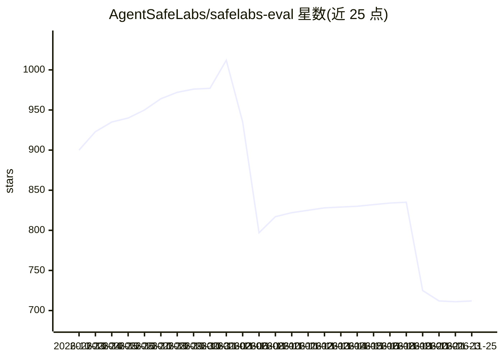

# AgentSafeLabs/safelabs-eval

⭐ 712 · Python · Apache-2.0 · 推送 2026-11-06 · [GitHub](https://github.com/AgentSafeLabs/safelabs-eval) · [官网](https://agentsafelabs.com) · 组织维护

**面向 AI Agent 的红队评测框架：300 条对抗提示覆盖 10 类 ASI**

围绕 OWASP 启发的 ASI01–ASI10 分类法构建的 AI Agent 红队与评测框架：对支持的 HTTP Agent 端点或 Python 可调用对象发射 300 条对抗提示（每类 30 条），用纯 Python 模式检测器评分（无需额外 LLM 调用），输出四档判定（VULNERABLE/FAIL/UNCERTAIN/PASS）与结构化报告，供 CI/CD 与审计流程使用。提供 CLI 与 Python API，支持 LangChain/CrewAI/AutoGen/LlamaIndex 等 7 个框架的可选适配器。提示库为英文、单轮，检测器可能漏检或误报。

## 筛选速览

| 维度 | 判定 | 备注 |
|---|---|---|
| AI 角色 | `ai-ecosystem` | LLM/agent 周边工具 |
| 许可风险 | `permissive` | Apache-2.0 |
| 部署形态 | `library` | 以包/库形式分发 |
| 模型依赖 | — | README 未给出锁定关系 |
| 硬件要求 | — | 无带数字的原话,不猜 |
| 安装摩擦 | `low` | 无编译、无系统依赖或容器化 |
| 成熟度 | `idea` | |

## 能力要点

- 300 条对抗提示按 10 个 ASI 类别组织，每类 30 条、难度分层 tier_1–tier_3
- 纯 Python 模式检测器评分，评测本身零额外 LLM 成本
- 框架无关接入：HTTP 端点或 Python 可调用对象（含 async）
- 每条提示携带 MITRE ATLAS 技术 ID 与 provenance 元数据（schema v1.1.0）

## 适用场景

- Agent 上线前对其做提示注入、越权等对抗性安全测试
- 在 CI/CD 流水线中生成结构化的 Agent 安全评测报告
- 按 ASI 类别审计 Agent 的数据泄露与幻觉风险

## 场景标签

`模型评测` · 领域:评测与运维

## 证据(README 行号)

> L14: **Open-source red-teaming and evaluation framework for AI agents — built around an OWASP-inspired agent-security ta
> L18: Point it at a supported HTTP agent endpoint — or wrap a Python callable — and it fires **300 curated adversarial pr
> L232: ## Framework Adapters

## 星数曲线

2026-10-23 900 → 2026-11-25 712（-188）

---
*卡片 v1 · prompt 1.4 · 生成 2026-11-24 · 置信度 high · 依据 README sha `1ebeffa64a66` · [字段定义](../../DATASET.md)*
