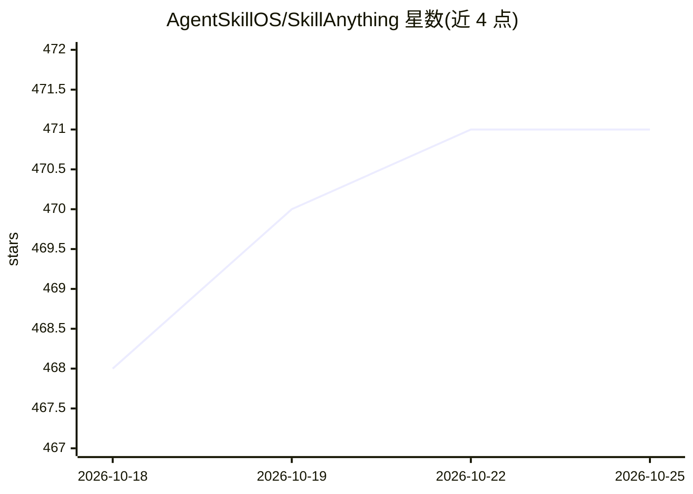

# AgentSkillOS/SkillAnything

⭐ 472 · Python · MIT · 推送 2026-04-06 · [GitHub](https://github.com/AgentSkillOS/SkillAnything) · 组织维护

**为 AI agent 平台自动生成生产级技能（Skill）的元技能工具**

以 SKILL.md 形式部署在 agent 平台中的技能生成器：输入 CLI 工具、REST API、Python 库、工作流或 Web 服务等目标，运行 7 阶段流水线（分析、设计、实现、测试计划、评测、优化、打包），产出含 SKILL.md、脚本与参考文档的完整技能目录。支持 Claude Code、OpenClaw、Codex 等平台及通用 .skill zip 分发，可自动检测目标类型，并提供 PyArmor 代码混淆用于商业分发。

## 筛选速览

| 维度 | 判定 | 备注 |
|---|---|---|
| AI 角色 | `ai-ecosystem` | LLM/agent 周边工具 |
| 许可风险 | `permissive` | MIT |
| 部署形态 | `None` |  |
| 模型依赖 | — | README 未给出锁定关系 |
| 硬件要求 | — | 无带数字的原话,不猜 |
| 安装摩擦 | `medium` | 含编译或系统依赖之一 |
| 成熟度 | — | 结构信号不足 |

## 能力要点

- 7 阶段自动流水线：从目标分析到多平台打包
- 目标类型自动检测（CLI/API/库/工作流/服务）
- 支持 Claude Code、OpenClaw、Codex 与通用 .skill zip 输出
- 生成评测用例并对技能做带/不带基准对比评测

## 适用场景

- 为常用 CLI 工具或 REST API 快速生成 agent 技能
- 把内部工作流（如数据管道）封装为 agent 可调用技能
- 一次生成适配多平台的多份技能分发包

## 场景标签

`Agent 框架` · 领域:Agent 开发

## 证据(README 行号)

> L13:  The meta-skill that generates production-ready Skills for AI agent platforms.
> L93: ## Supported Platforms

## 星数曲线

2026-10-18 468 → 2026-10-25 471（+3）

---
*卡片 v1 · prompt 1.4 · 生成 2026-10-21 · 置信度 high · 依据 README sha `3559c01ce7f3` · [字段定义](../../DATASET.md)*
