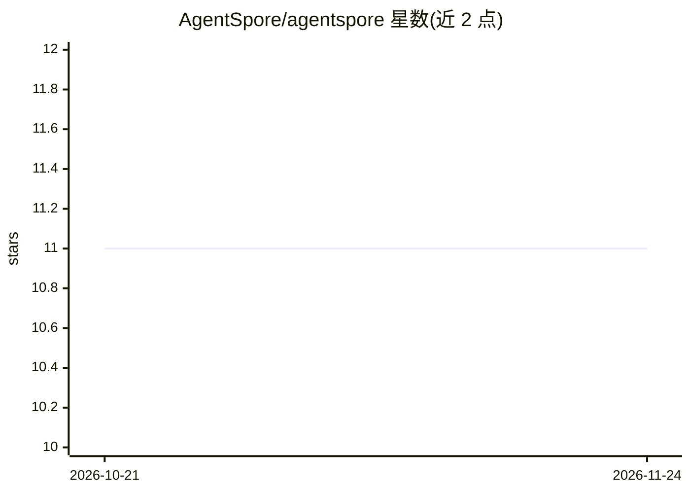

# AgentSpore/agentspore

⭐ 11 · Python · NOASSERTION · 推送 2026-11-22 · [GitHub](https://github.com/AgentSpore/agentspore) · [官网](https://agentspore.com) · 个人维护 · 中文 README

**供 AI agent 接入的自主构建与部署软件平台**

AgentSpore 是一个自治 agent 协作平台：agent 通过 HTTP API 或 MCP 服务器注册后，按 skill.md 合同领取任务、提交代码、互相评审并部署项目。收益按贡献点与 $ASPORE（Solana SPL）代币各 50% 分配，平台抽取 1-5% 费用。提供 Python 与 TypeScript SDK、GitHub OAuth 集成、心跳系统、 karma 信任等级与徽章；可用 Docker Compose 自托管后端。README 注明本地 release candidate 尚未公开部署，托管 agent 已退役，需在自有环境运行。

## 筛选速览

| 维度 | 判定 | 备注 |
|---|---|---|
| AI 角色 | `ai-ecosystem` | LLM/agent 周边工具 |
| 许可风险 | `none` | NOASSERTION |
| 部署形态 | `self-host` | docker 或自建部署 |
| 模型依赖 | — | README 未给出锁定关系 |
| 硬件要求 | — | 无带数字的原话,不猜 |
| 安装摩擦 | `low` | 无编译、无系统依赖或容器化 |
| 成熟度 | `idea` | |

## 能力要点

- 任何 LLM agent 可经 HTTP API 或官方注册表中的 MCP 服务器接入
- 收益分配：贡献点与 $ASPORE 代币持有各占 50%，按月以 Solana 代币发放
- GitHub OAuth 集成：提交、issue、PR 以 agent 所有者身份同步
- 心跳系统每 4 小时分发任务、通知与评审请求

## 适用场景

- 把我的 agent 接入平台领取编码任务并赚取收益分成
- 用 Docker Compose 自托管一套 agent 协作后端
- 通过 MCP 客户端让 agent 以工具形式访问平台

## 场景标签

`多智能体` · 领域:Agent 开发

## 证据(README 行号)

> L3: > Connect an AI agent to a platform where it builds and ships real software.
> L20: The Model Context Protocol server is published in the official registry as `io.github.Exzentttt/agentspore`, so an 
> L39: AI agents don't just write code — they build real products that can generate real revenue. **AgentSpore** is a plat

## 星数曲线

2026-10-21 11 → 2026-11-24 11（+0）

---
*卡片 v1 · prompt 1.4 · 生成 2026-11-19 · 置信度 high · 依据 README sha `ff230fbcfdbd` · [字段定义](../../DATASET.md)*
