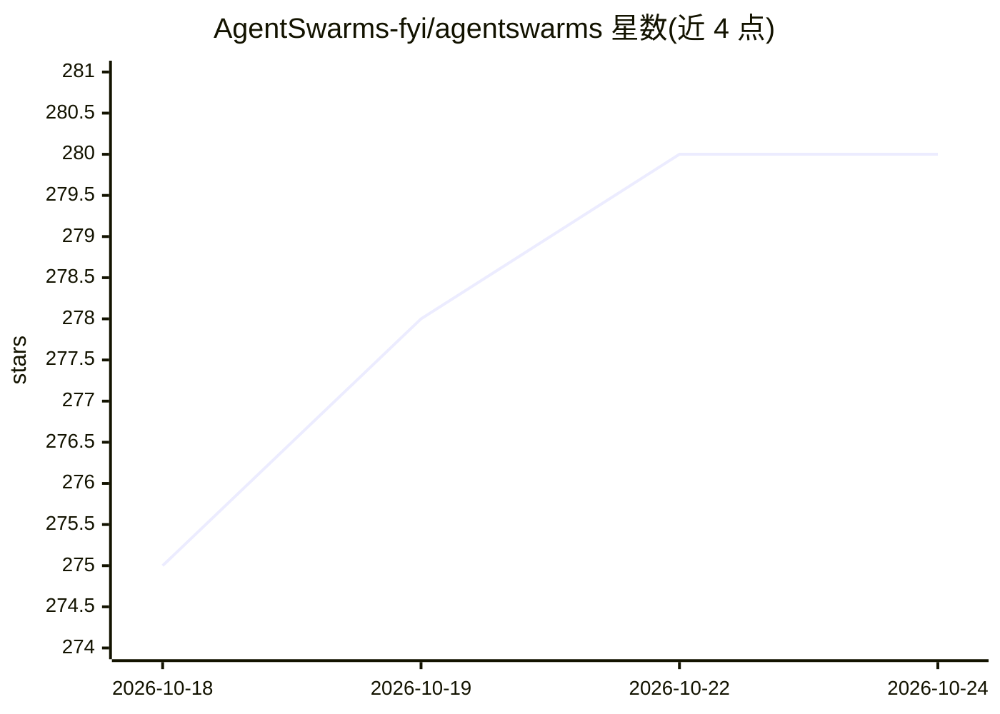

# AgentSwarms-fyi/agentswarms

⭐ 280 · TypeScript · NOASSERTION · 推送 2026-10-23 · [GitHub](https://github.com/AgentSwarms-fyi/agentswarms) · [官网](https://agentswarms.fyi) · 组织维护

**自托管的 Agentic AI 与数据一体化平台（代理+湖仓+BI+ML）**

面向需要在自有基础设施上运行 AI 与数据的团队：一侧提供代理聊天、多代理 Swarm 画布、RAG 知识库与 MCP；另一侧提供 ETL 管道、DuckDB+Parquet 湖仓、BI 仪表盘、展示 SQL 的 AI 分析师与无代码机器学习。统一语义层、数据目录（表级与列级血缘）、IAM 与哈希链审计贯穿两侧；模型规则、预算、行过滤在服务端强制执行。支持多种模型提供商（OpenRouter/OpenAI/Anthropic/Gemini/Bedrock/Azure/Ollama/vLLM 等）与 39 个数据连接器。以一个 Supabase 项目加一条 Docker 命令运行，采用 Elastic License 2.0（源码可用，非 OSI 开源）。

## 筛选速览

| 维度 | 判定 | 备注 |
|---|---|---|
| AI 角色 | `ai-native` | 本体是模型或模型工具 |
| 许可风险 | `none` | NOASSERTION |
| 部署形态 | `self-host` | docker 或自建部署 |
| 模型依赖 | local-ok | 支持本地模型 |
| 硬件要求 | — | 无带数字的原话,不猜 |
| 安装摩擦 | `low` | 无编译、无系统依赖或容器化 |
| 成熟度 | — | 结构信号不足 |

## 能力要点

- 代理/RAG 与 ETL/湖仓/BI/ML 在同一平台，共享登录、权限模型与审计日志
- AI 分析师展示其 SQL，每个数字引用其步骤；训练的模型记录指标、血缘与模型卡
- 服务端治理：模型规则、支出预算、行过滤与列掩码在调用前强制执行
- Swarm 画布中的多代理工作流图可从画布、API 或按计划运行，发布快照机制

## 适用场景

- 在自有基础设施上构建 AI 代理与多代理工作流并接入企业数据
- 搭建自有的湖仓与 BI 仪表盘并用 AI 分析师做对话式分析
- 对湖仓表做无代码机器学习（预测、预测、聚类、异常、推荐）并纳入治理

## 场景标签

`Agent 框架` `多智能体` `聊天机器人` `RAG` · 领域:Agent 开发

## 证据(README 行号)

> L1: AgentSwarms — self-hosted agentic AI and data platform: AI agents, multi-agent swarms, RAG, ETL pipelines, a lakehou
> L27: DuckDB-and-Parquet lakehouse you own, BI dashboards, an AI analyst that shows
> L45: - **Any model, any warehouse** — OpenRouter, OpenAI, Anthropic, Gemini, Bedrock,

## 星数曲线

2026-10-18 275 → 2026-10-24 280（+5）

---
*卡片 v1 · prompt 1.4 · 生成 2026-10-22 · 置信度 mid · 依据 README sha `622e24114707` · [字段定义](../../DATASET.md)*
