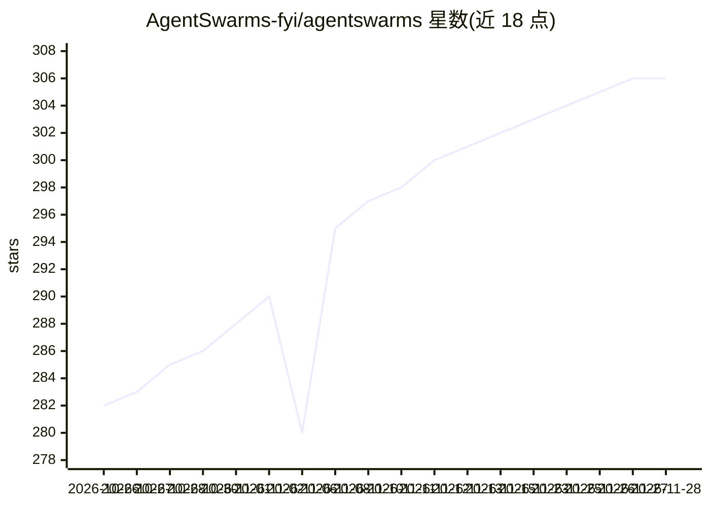

# AgentSwarms-fyi/agentswarms

⭐ 306 · TypeScript · NOASSERTION · 推送 2026-11-27 · [GitHub](https://github.com/AgentSwarms-fyi/agentswarms) · [官网](https://agentswarms.fyi) · 组织维护

**自托管代理 AI 与数据平台：agent、RAG、ETL、湖仓与 BI 一体**

AgentSwarms 是一个自托管（self-hosted）的开源可用（source-available）代理 AI 与数据平台：一侧提供 agent 聊天、多 agent 工作流画布、RAG 知识库与 MCP；另一侧提供 ETL 管道、DuckDB+Parquet 湖仓、BI 仪表板、展示 SQL 的 AI 分析师与无代码机器学习。统一语义层、数据目录、IAM 与哈希链审计日志贯穿全部功能。许可为 Elastic License 2.0，运行依赖一个 Supabase 项目和一条 Docker 命令，使用用户自己的模型密钥。

## 筛选速览

| 维度 | 判定 | 备注 |
|---|---|---|
| AI 角色 | `ai-native` | 本体是模型或模型工具 |
| 许可风险 | `none` | NOASSERTION |
| 部署形态 | `self-host` | docker 或自建部署 |
| 模型依赖 | local-ok | 支持本地模型 |
| 硬件要求 | — | 无带数字的原话,不猜 |
| 安装摩擦 | `low` | 无编译、无系统依赖或容器化 |
| 成熟度 | — | 结构信号不足 |

## 能力要点

- 多 agent 工作流画布：节点含 agent、路由、条件、循环、人工审批等，可从画布、API 或定时触发运行
- AI Analyst 将问题规划为步骤、编写并执行 SQL，每个数字引用其来源步骤
- 无代码 ML：自动特征准备、多算法训练、指标看板、漂移报告与模型卡
- 40 个数据连接器（22 数据库/仓库 + 18 应用），RAG 支持 pgvector 或 Qdrant

## 适用场景

- 在自己的基础设施上搭建带治理的 agent 与多 agent 工作流
- 为业务数据搭建统一湖仓、ETL 管道与 BI 仪表板
- 用 AI 分析师对自有数据做可核查的对话式分析
- 在无代码界面训练与注册机器学习模型并回写湖仓

## 场景标签

`Agent 框架` `多智能体` `工作流自动化` `聊天机器人` · 领域:Agent 开发

## 证据(README 行号)

> L1: AgentSwarms — self-hosted agentic AI and data platform: AI agents, multi-agent swarms, RAG, ETL pipelines, a lakehou
> L24: Most agent platforms stop at the agent and leave the data to you. **AgentSwarms**
> L45: - **Any model, any warehouse** — OpenRouter, OpenAI, Anthropic, Gemini, Bedrock,

## 星数曲线

2026-10-26 282 → 2026-11-28 306（+24）

---
*卡片 v1 · prompt 1.4 · 生成 2026-11-25 · 置信度 high · 依据 README sha `95113a25bf40` · [字段定义](../../DATASET.md)*
