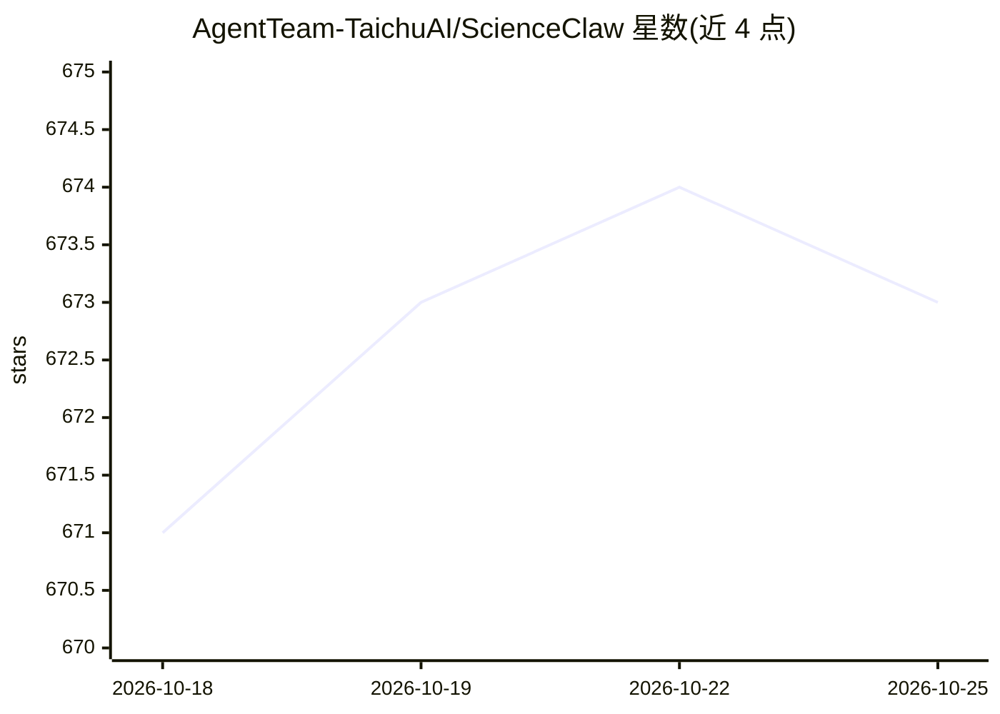

# AgentTeam-TaichuAI/ScienceClaw

⭐ 673 · Python · 推送 2026-05-09 · [GitHub](https://github.com/AgentTeam-TaichuAI/ScienceClaw) · [官网](https://scienceclaw.zidongtaichu.com/) · 组织维护 · 中文 README

**本地运行的科研 Agent 助手：Docker 沙箱内调用 1900+ 科学工具**

面向科研人员、开发者与学生的个人研究助理，基于 LangChain DeepAgents 与 AIO Sandbox 构建，整体运行于 Docker 容器内，代码执行隔离在沙箱，数据保留在本地 workspace 目录。内置 ToolUniverse 的 1,900+ 科学工具，覆盖药物发现、天文、地学、化学、生态、文献检索等领域；支持 SKILL.md 技能系统与自定义 @tool 热加载，可生成 PDF/DOCX/PPTX/XLSX 格式报告，提供飞书通知、定时任务与资源监控。Windows 提供桌面安装包，macOS/Linux 通过 Docker Compose 部署，另有官方云版本。

## 筛选速览

| 维度 | 判定 | 备注 |
|---|---|---|
| AI 角色 | `ai-native` | 本体是模型或模型工具 |
| 许可风险 | `none` | — |
| 部署形态 | `self-host` | docker 或自建部署 |
| 模型依赖 | — | README 未给出锁定关系 |
| 硬件要求 | — | 无带数字的原话,不猜 |
| 安装摩擦 | `low` | 无编译、无系统依赖或容器化 |
| 成熟度 | — | 结构信号不足 |

## 能力要点

- 1,900+ 科学工具（ToolUniverse）覆盖药物发现、天文、地学、化学、文献等领域
- 全 Docker 沙箱运行，Agent 无法访问宿主系统，数据留在本地
- 四层工具架构与 SKILL.md 技能系统，支持自然语言创建工具/技能
- 生成 PDF/DOCX/PPTX/XLSX 四种格式研究报告

## 适用场景

- 科研场景下让 Agent 检索文献、分析数据并生成研究报告
- 在本地隔离沙箱中安全运行代码与科学计算工具
- 通过飞书接收定时任务的自动执行结果

## 场景标签

`科研工具` `数据分析` · 领域:效率与自动化

## 证据(README 行号)

> L5: ScienceClaw is a personal research assistant built with LangChain DeepAgents and AIO Sandbox infrastructure, adoptin
> L7: *1,900+ built-in scientific tools · Multi-format content generation · Fully local & privacy-first*
> L136: ScienceClaw integrates **ToolUniverse**, a unified ecosystem of 1,900+ scientific tools spanning **multiple discip

## 星数曲线

2026-10-18 671 → 2026-10-25 673（+2）

---
*卡片 v1 · prompt 1.4 · 生成 2026-10-21 · 置信度 high · 依据 README sha `30689f98ddfc` · [字段定义](../../DATASET.md)*
