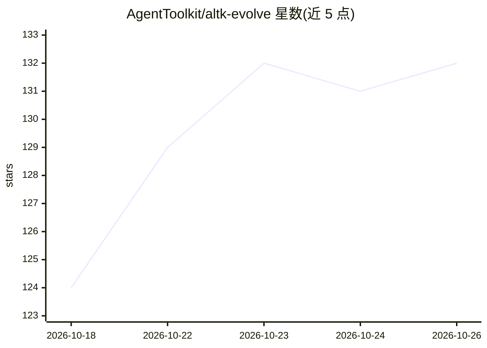

# AgentToolkit/altk-evolve

⭐ 132 · Python · Apache-2.0 · 推送 2026-10-23 · [GitHub](https://github.com/AgentToolkit/altk-evolve) · [官网](https://agenttoolkit.github.io/altk-evolve/) · 组织维护

**让 AI agent 从轨迹中学习经验的记忆中间件（IBM）**

通过 MCP 服务器接入 Claude Code、Codex、IBM Bob 等编码 agent，将对话轨迹提取为 guidelines 存入数据库并反馈给 agent，实现跨会话记忆与自我改进。组合机制包括 MCP 工具集成、向量存储（默认文件系统后端，可选 pgvector/Milvus）与基于 LLM 的冲突消解；Lite 版可直接嵌入现有 agent 助手。支持实体跨命名空间发布共享、保留策略管理与 Web UI；本地 API 无鉴权为声明限制。以 Python 包（altk-evolve / altk-evolve-core）与源码方式提供。

## 筛选速览

| 维度 | 判定 | 备注 |
|---|---|---|
| AI 角色 | `ai-ecosystem` | LLM/agent 周边工具 |
| 许可风险 | `permissive` | Apache-2.0 |
| 部署形态 | `library` | 以包/库形式分发 |
| 模型依赖 | — | README 未给出锁定关系 |
| 硬件要求 | — | 无带数字的原话,不猜 |
| 安装摩擦 | `low` | 无编译、无系统依赖或容器化 |
| 成熟度 | — | 结构信号不足 |

## 能力要点

- 从 agent 轨迹生成 guidelines 并自动应用于新任务
- MCP server + 向量存储 + LLM 冲突消解的反馈循环架构
- 实体跨命名空间 public/private 共享与保留策略（retention）管理
- 可选 pgvector/Milvus 后端，默认文件系统后端零额外依赖

## 适用场景

- 给我的 Claude Code / Codex agent 加上跨会话经验记忆
- 多个 agent 之间共享沉淀的操作指南
- 在生产环境用 pgvector 管理大规模 agent 记忆库

## 场景标签

`Agent 记忆` · 领域:Agent 开发

## 证据(README 行号)

> L13: Evolve is a system designed to help agents improve over time by learning from their trajectories. The Lite version 
> L194: Evolve is built on a modular architecture which forms a feedback loop, taking conversation traces (trajectories) f

## 星数曲线

2026-10-18 124 → 2026-10-26 132（+8）

---
*卡片 v1 · prompt 1.4 · 生成 2026-10-22 · 置信度 mid · 依据 README sha `040a558616f5` · [字段定义](../../DATASET.md)*
