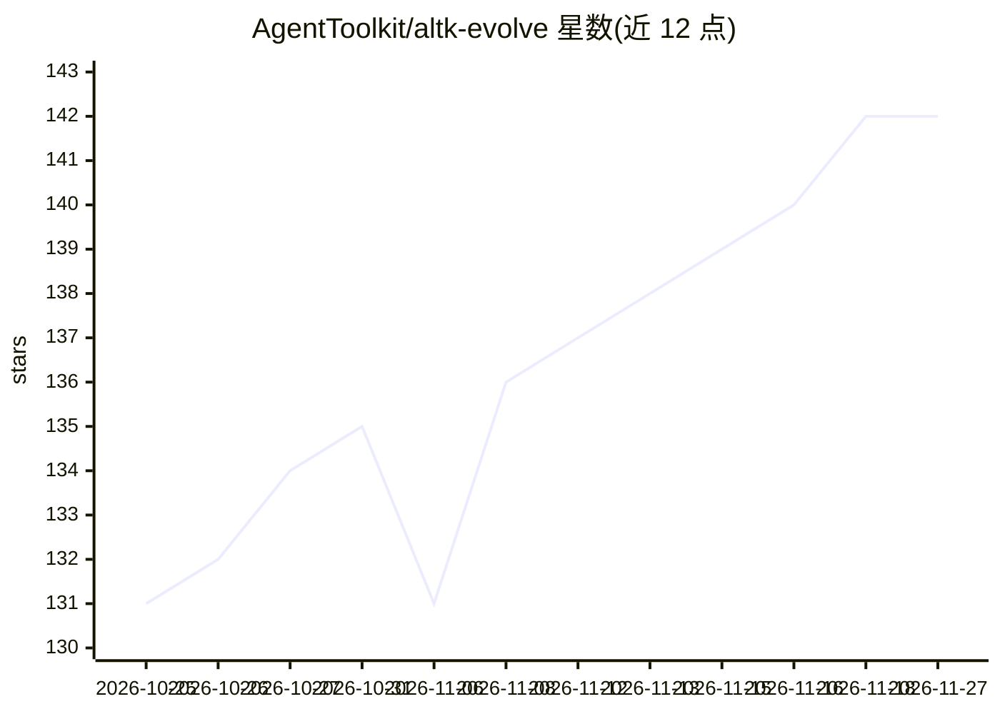

# AgentToolkit/altk-evolve

⭐ 142 · Python · Apache-2.0 · 推送 2026-11-25 · [GitHub](https://github.com/AgentToolkit/altk-evolve) · [官网](https://agenttoolkit.github.io/altk-evolve/) · 组织维护

**让 AI agent 从历史轨迹学习可复用准则的记忆中间件**

Evolve 将 agent 的过往执行轨迹转化为可复用的 guideline，在新任务中检索注入，不改变模型权重。Lite 版嵌入 Claude Code、Codex 等现有助手；完整版提供 MCP 服务器、向量存储记忆与基于 LLM 的冲突消解，支持 guideline 合并与聚类，保留来源与支持计数。安装方式包括 PyPI 包与源码构建，存储后端可选文件系统、pgvector、Milvus，文本嵌入需安装 fastembed 或 sentence-transformers 额外依赖。README 给出 AppWorld 与 τ²-bench 上的自报评测结果。

## 筛选速览

| 维度 | 判定 | 备注 |
|---|---|---|
| AI 角色 | `ai-ecosystem` | LLM/agent 周边工具 |
| 许可风险 | `permissive` | Apache-2.0 |
| 部署形态 | `library` | 以包/库形式分发 |
| 模型依赖 | — | README 未给出锁定关系 |
| 硬件要求 | — | 无带数字的原话,不猜 |
| 安装摩擦 | `low` | 无编译、无系统依赖或容器化 |
| 成熟度 | — | 结构信号不足 |

## 能力要点

- 将历史轨迹转为 guideline 并在新任务中自动检索应用
- MCP 服务器提供轨迹保存、guideline 检索、保留策略等 20+ 工具
- LLM 冲突消解与 guideline 聚类合并，保留支持计数与来源
- 多后端存储：文件系统（默认）、pgvector、Milvus

## 适用场景

- 为 Claude Code 或 Codex 助手挂载经验记忆
- 为自建 agent 系统接入 MCP 记忆服务
- 跨命名空间发布共享 guideline 给其他 agent

## 场景标签

`Agent 记忆` · 领域:Agent 开发

## 证据(README 行号)

> L11: Evolve helps AI agents learn from experience. It turns past trajectories into reusable guidelines that help agents 
> L13: The Lite version is designed to effortlessly slot into existing agent assistants like Claude Code and Codex. The fu

## 星数曲线

2026-10-25 131 → 2026-11-27 142（+11）

---
*卡片 v1 · prompt 1.4 · 生成 2026-11-27 · 置信度 mid · 依据 README sha `46423fd19aae` · [字段定义](../../DATASET.md)*
