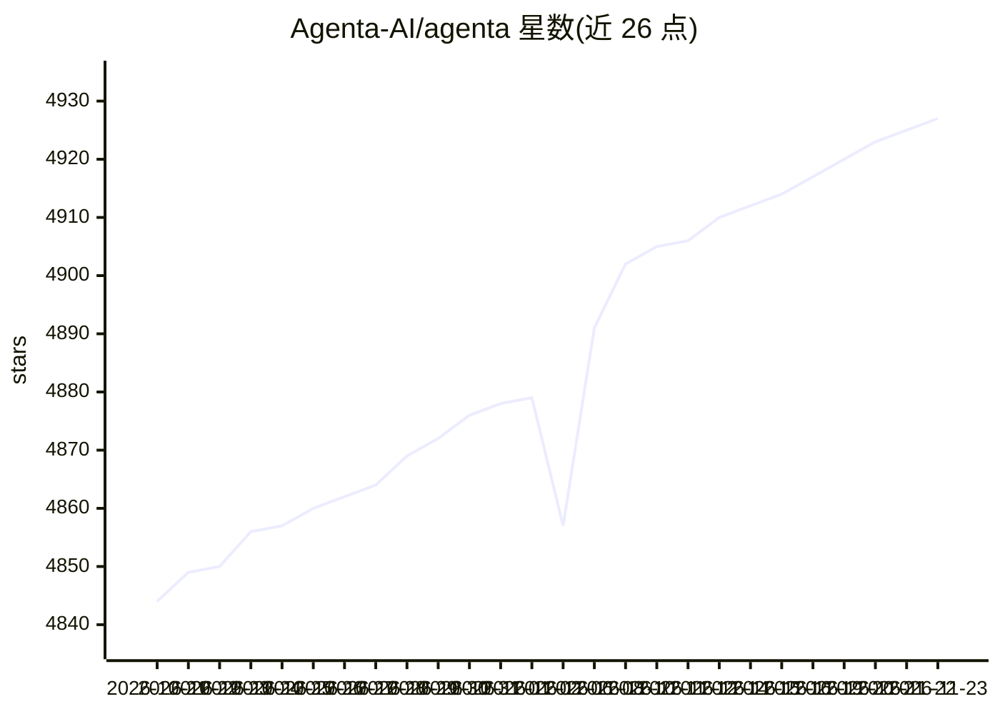

# Agenta-AI/agenta

⭐ 4,927 · TypeScript · NOASSERTION · 推送 2026-11-22 · [GitHub](https://github.com/Agenta-AI/agenta) · [官网](http://www.agenta.ai) · 组织维护 · 中文 README

**开源的团队 Agent 工作台：对话式构建 AI 同事与自动化**

Agenta 是一个开源（MIT）的 Agent 工作区，用户通过对话描述工作来构建专职 Agent，可连接应用并按反馈迭代；Agent 可通过 Slack、Telegram 或 WhatsApp Business 被团队使用，并支持按计划或事件触发的自动化。机制上：每个 Agent 在独立沙箱会话中运行、支持按 Agent 设置工具权限、每次运行有追踪与成本记录、Agent 具备记忆与自建技能。可通过 Agenta Cloud 使用或自行托管；部署说明通过安装一个自托管技能来引导完成。

## 筛选速览

| 维度 | 判定 | 备注 |
|---|---|---|
| AI 角色 | `ai-native` | 本体是模型或模型工具 |
| 许可风险 | `none` | NOASSERTION |
| 部署形态 | `library` | 以包/库形式分发 |
| 模型依赖 | local-ok | 支持本地模型 |
| 硬件要求 | — | 无带数字的原话,不猜 |
| 安装摩擦 | `low` | 无编译、无系统依赖或容器化 |
| 成熟度 | — | 结构信号不足 |

## 能力要点

- 对话式构建 Agent，支持 Slack/Telegram/WhatsApp 中的使用
- 自动化运行：按计划或连接应用的事件触发，可查看每次运行记录
- 会话级沙箱隔离、工具读写权限控制、运行追踪与成本记录
- 接入 MCP 与 Composio（1,000+ 应用），支持 Ollama 自托管模型

## 适用场景

- 为 IT 运维、GTM、HR、法务、财务等团队构建共享的自动化 Agent
- 在 Slack 等团队工具中直接与 Agent 协作
- 无需代码构建潜客调研与外联回复的自动化流程
- 自托管并用自己的模型与数据运行 Agent 平台

## 场景标签

`工作流自动化` `聊天机器人` `AI 助手` · 领域:效率与自动化

## 证据(README 行号)

> L59: Agenta is an open-source workspace where you build specialized agents that automate and augment your work.
> L63: You can work with your agents in the web app, or talk to them where you already are: **Slack**, **Telegram** or **W

## 星数曲线

2026-10-21 4,844 → 2026-11-23 4,927（+83）

---
*卡片 v1 · prompt 1.4 · 生成 2026-11-23 · 置信度 low · 依据 README sha `dc59a1b1e2ba` · [字段定义](../../DATASET.md)*
