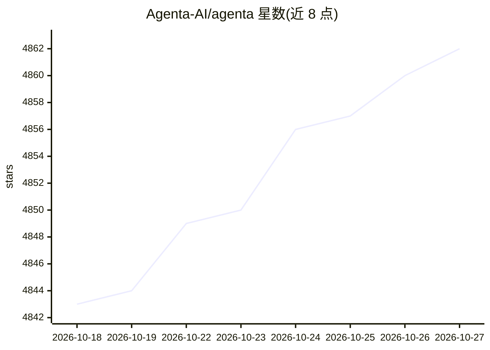

# Agenta-AI/agenta

⭐ 4,862 · TypeScript · NOASSERTION · 推送 2026-10-26 · [GitHub](https://github.com/Agenta-AI/agenta) · [官网](http://www.agenta.ai) · 组织维护 · 中文 README

**面向团队的开源 agent 工作区：聊天式构建、共享与运行 AI 同事**

开源的团队 agent 工作区：用户通过对话描述工作、连接应用，构建自动化和增强工作的 agent，并可在 Web 应用或 Slack、Telegram、WhatsApp 中使用。agent 可按计划或事件触发自动运行，每次运行有追踪与成本记录。提供沙箱隔离、按 agent 的权限控制、记忆与技能自建机制，支持接入 API 托管模型或经 Ollama 自托管模型，可经 MCP 与 Composio 连接上千应用。提供云端版与自托管两种使用方式，自托管通过安装技能由 agent 引导完成。

## 筛选速览

| 维度 | 判定 | 备注 |
|---|---|---|
| AI 角色 | `ai-ecosystem` | LLM/agent 周边工具 |
| 许可风险 | `none` | NOASSERTION |
| 部署形态 | `library` | 以包/库形式分发 |
| 模型依赖 | local-ok | 支持本地模型 |
| 硬件要求 | — | 无带数字的原话,不猜 |
| 安装摩擦 | `low` | 无编译、无系统依赖或容器化 |
| 成熟度 | — | 结构信号不足 |

## 能力要点

- 通过对话构建 agent，非技术成员也可参与
- 在 Slack、Telegram、WhatsApp 中与 agent 协作
- 自动按计划或事件运行，每次运行可追踪与审计成本
- 支持 MCP 集成与经 Composio 连接 1,000+ 应用，可自托管模型（Ollama）

## 适用场景

- 团队共享地构建和管理自动化 agent，替代重复工作
- 让 agent 定期做竞品调研等例行任务并把结果送到 Gmail
- 在团队已有的聊天工具中直接使用和共享 agent

## 场景标签

`工作流自动化` `Agent 框架` · 领域:Agent 开发

## 证据(README 行号)

> L59: Agenta is an open-source workspace where you build specialized agents that automate and augment your work.
> L61: You build agents by chatting with them. You describe the work, connect the apps they need, and improve them through

## 星数曲线

2026-10-18 4,843 → 2026-10-27 4,862（+19）

---
*卡片 v1 · prompt 1.4 · 生成 2026-10-20 · 置信度 mid · 依据 README sha `8758885679ae` · [字段定义](../../DATASET.md)*
