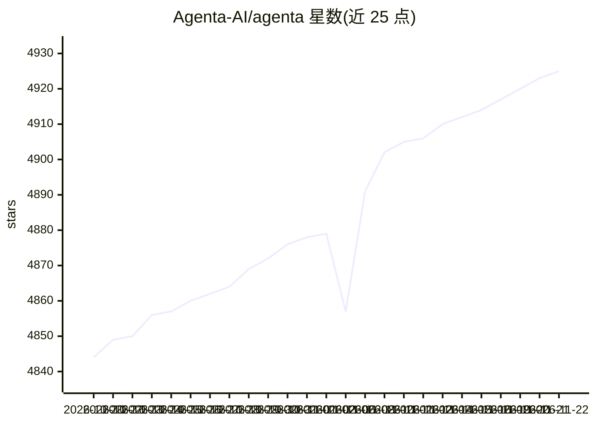

# Agenta-AI/agenta

⭐ 4,925 · TypeScript · NOASSERTION · 推送 2026-11-21 · [GitHub](https://github.com/Agenta-AI/agenta) · [官网](http://www.agenta.ai) · 组织维护 · 中文 README

**团队构建与共享 AI agent 的开源工作区**

Agenta 是一个开源工作区，用户通过对话构建专用 agent 并为团队共享：描述任务、连接所需应用、根据反馈迭代。agent 可在网页端使用，也可通过 Slack、Telegram 或 WhatsApp Business 交互；支持定时或事件触发的自动化运行并记录每次执行。内置多用户角色与权限控制、每次运行的沙箱隔离、配置版本、成本追踪与调用轨迹，支持自托管并接入自有模型。定位面向 IT、GTM、HR、法务、财务、支持等非纯编码工作场景。

## 筛选速览

| 维度 | 判定 | 备注 |
|---|---|---|
| AI 角色 | `ai-ecosystem` | LLM/agent 周边工具 |
| 许可风险 | `none` | NOASSERTION |
| 部署形态 | `library` | 以包/库形式分发 |
| 模型依赖 | local-ok | 支持本地模型 |
| 硬件要求 | — | 无带数字的原话,不猜 |
| 安装摩擦 | `low` | 无编译、无系统依赖或容器化 |
| 成熟度 | — | 结构信号不足 |

## 能力要点

- 通过对话构建 agent，团队共享、多用户、带角色权限
- 每次运行有沙箱隔离、轨迹追踪与成本记录
- 通过 MCP 及 Composio 接入 1,000+ 应用（Gmail/Slack/Notion/GitHub）
- 支持 Claude Code、Pi、Codex 等 harness 与 Ollama 自托管模型

## 适用场景

- 让团队在 Slack 里直接使用共享的业务 agent
- 为周期性工作设置定时或事件触发的自动化
- 为非技术成员提供免代码的 agent 构建方式
- 自托管 agent 平台并接入自有模型与数据

## 场景标签

`工作流自动化` `LLM 可观测性` · 领域:效率与自动化

## 证据(README 行号)

> L59: Agenta is an open-source workspace where you build specialized agents that automate and augment your work.
> L105: 5. **Auditable.** Every run is traced. Every cost is tracked.
> L123: **Integrations.** Connect your agents through MCP, or to more than 1,000 apps through Composio, including Gmail, S

## 星数曲线

2026-10-20 4,844 → 2026-11-22 4,925（+81）

---
*卡片 v1 · prompt 1.4 · 生成 2026-11-22 · 置信度 mid · 依据 README sha `af9975cf3970` · [字段定义](../../DATASET.md)*
