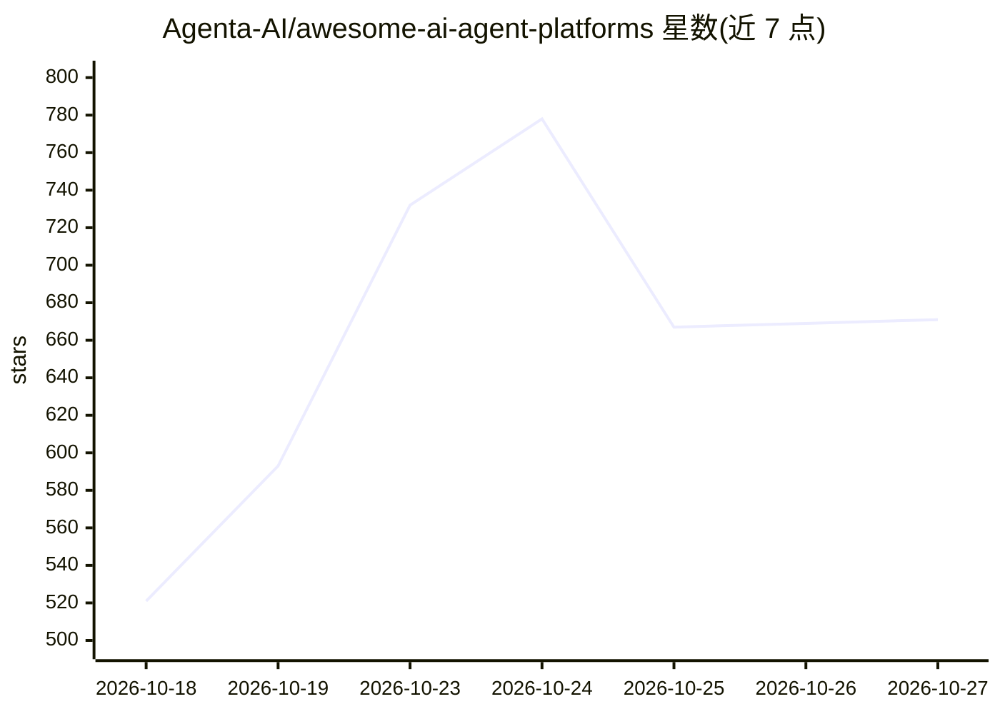

# Agenta-AI/awesome-ai-agent-platforms

⭐ 671 · Astro · CC0-1.0 · 推送 2026-10-01 · [GitHub](https://github.com/Agenta-AI/awesome-ai-agent-platforms) · [官网](https://aiagentplatforms.dev) · 组织维护

**开源 AI agent 平台策展清单，含许可证与托管信息**

一个 awesome 类策展清单，收录开源 AI agent 平台，按六类组织：AI 同事/队友、agent 构建框架、工作流自动化平台、浏览器 agent、编码 agent。每个条目附一段描述、许可证与托管方式（自托管/厂商托管/本地运行）。列出收录标准：可用产品或框架、许可证与托管信息可验证、仍在维护；声明收录不代表背书。另提供 aiagentplatforms.dev 网站与对比表供浏览。面向选型 AI agent 平台或框架的开发者与团队。

## 筛选速览

| 维度 | 判定 | 备注 |
|---|---|---|
| AI 角色 | `ai-knowledge` | 知识聚合/清单类 |
| 许可风险 | `viral` | CC0-1.0 |
| 部署形态 | `None` |  |
| 模型依赖 | — | README 未给出锁定关系 |
| 硬件要求 | — | 无带数字的原话,不猜 |
| 安装摩擦 | `low` | 无编译、无系统依赖或容器化 |
| 成熟度 | — | 结构信号不足 |

## 能力要点

- 按 6 个类别组织条目，每条含许可证与托管说明
- 明确列出 4 条收录与筛选标准（排除纯演示仓库与已停更项目）
- 提供配套网站 aiagentplatforms.dev 与完整对比表

## 适用场景

- 为团队选型开源 AI agent 平台或构建框架
- 对比各平台的许可证与自托管/托管方式
- 了解 AI agent 平台领域的品类划分与代表项目

## 场景标签

`精选清单` · 领域:学习与行业

## 证据(README 行号)

> L3: > A curated list of open-source AI agent platforms: AI coworkers and teammates, agent builders and frameworks, workf
> L5: AI coworkers are persistent agents that people delegate real work to: they sign in to tools, keep context, run on sc

## 星数曲线

2026-10-18 521 → 2026-10-27 671（+150）

---
*卡片 v1 · prompt 1.4 · 生成 2026-10-22 · 置信度 high · 依据 README sha `170a74bbaa49` · [字段定义](../../DATASET.md)*
