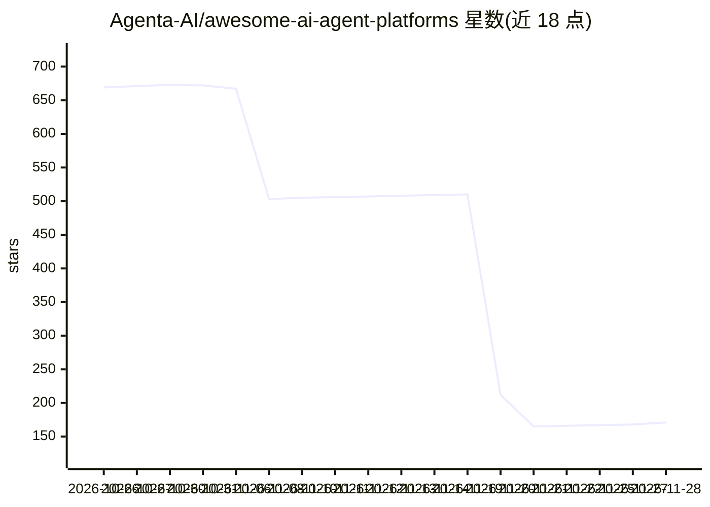

# Agenta-AI/awesome-ai-agent-platforms

⭐ 171 · Astro · CC0-1.0 · 推送 2026-11-06 · [GitHub](https://github.com/Agenta-AI/awesome-ai-agent-platforms) · [官网](https://aiagentplatforms.dev) · 组织维护

**开源 AI Agent 平台分类清单（带许可与托管信息）**

收录开源 AI Agent 平台的策展清单，分五类组织：AI 同事与协作体、Agent 构建框架、工作流自动化平台、浏览器 Agent 与编码 Agent，每条条目标注许可证与托管方式（自托管/本地桌面/厂商托管）。附带收录标准（需有活跃仓库、可验证许可、持续维护）及在线对比网站；清单本身以 CC0 许可发布。

## 筛选速览

| 维度 | 判定 | 备注 |
|---|---|---|
| AI 角色 | `ai-knowledge` | 知识聚合/清单类 |
| 许可风险 | `viral` | CC0-1.0 |
| 部署形态 | `None` |  |
| 模型依赖 | — | README 未给出锁定关系 |
| 硬件要求 | — | 无带数字的原话,不猜 |
| 安装摩擦 | `low` | 无编译、无系统依赖或容器化 |
| 成熟度 | — | 结构信号不足 |

## 能力要点

- 五类条目组织，每条标注许可证与托管模式
- Flowife 条目标注 end-of-life 日期（2026-08-31）
- 提供在线对比表网站
- 含明确的收录与排除标准

## 适用场景

- 为团队自托管选型对比 AI 同事平台
- 开发者为 Agent 项目挑选框架
- 查找可自托管的浏览器或编码 Agent

## 场景标签

`精选清单` · 领域:学习与行业

## 证据(README 行号)

> L3: > A curated list of open-source AI agent platforms: AI coworkers and teammates, agent builders and frameworks, workf
> L92: An entry must:

## 星数曲线

2026-10-26 669 → 2026-11-28 171（-498）

---
*卡片 v1 · prompt 1.4 · 生成 2026-11-27 · 置信度 high · 依据 README sha `6b1e01040f59` · [字段定义](../../DATASET.md)*
