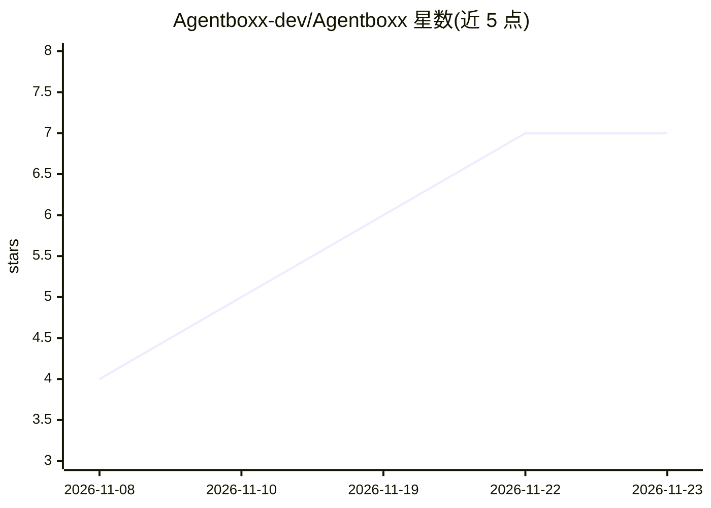

# Agentboxx-dev/Agentboxx

⭐ 7 · Python · Apache-2.0 · 推送 2026-11-22 · [GitHub](https://github.com/Agentboxx-dev/Agentboxx) · [官网](https://pypi.org/project/agentboxx/) · 组织维护

**AI agent 防篡改运行记录器：沙箱执行、签名审计、循环检测**

从宿主侧观察 agent 行为的记录工具：输出、退出码与耗时由宿主捕获而非 agent 自报，日志经哈希链与 HMAC 签名，提供 agentbox verify 完整性校验、Ed25519 运行回执供第三方审计。含状态感知循环检测、Docker 加固沙箱（无网络、只读根文件系统）、MCP/函数工具调用记录、任务契约与宿主侧断言，并提供 report/replay/bundle CLI。需要 Python 3.10+，Docker 为沙箱演示可选。

## 筛选速览

| 维度 | 判定 | 备注 |
|---|---|---|
| AI 角色 | `ai-ecosystem` | LLM/agent 周边工具 |
| 许可风险 | `permissive` | Apache-2.0 |
| 部署形态 | `library` | 以包/库形式分发 |
| 模型依赖 | — | README 未给出锁定关系 |
| 硬件要求 | — | 无带数字的原话,不猜 |
| 安装摩擦 | `low` | 无编译、无系统依赖或容器化 |
| 成熟度 | `idea` | |

## 能力要点

- 哈希链 + HMAC 签名的防篡改事件日志，Ed25519 回执支持仅持公钥的第三方验证
- 状态感知循环检测（loop.exact/error_repeat/no_progress/cycle），警告以 hint 回注模型
- Docker 加固沙箱与宿主侧资源/崩溃事件记录
- record_tool_call 记录 MCP、LangChain 等框架的工具调用并自动脱敏

## 适用场景

- 审计 agent 运行痕迹，检测日志是否被篡改
- 调试陷入循环、幻觉或崩溃的 agent
- 给 LangChain/LangGraph agent 的工具调用加签名记录
- 以任务契约与宿主侧断言验证 agent 是否真的完成任务

## 场景标签

`LLM 可观测性` · 领域:评测与运维

## 证据(README 行号)

> L16: Most agent tooling records what the agent *says* it did, from inside the agent's own process. agentbox observes fro
> L40: |`recorder.py`|Main API: `Recorder.run()`, `record_step()`, `record_tool_call()`|

## 星数曲线

2026-11-08 4 → 2026-11-23 7（+3）

---
*卡片 v1 · prompt 1.4 · 生成 2026-11-20 · 置信度 high · 依据 README sha `fb3207228998` · [字段定义](../../DATASET.md)*
