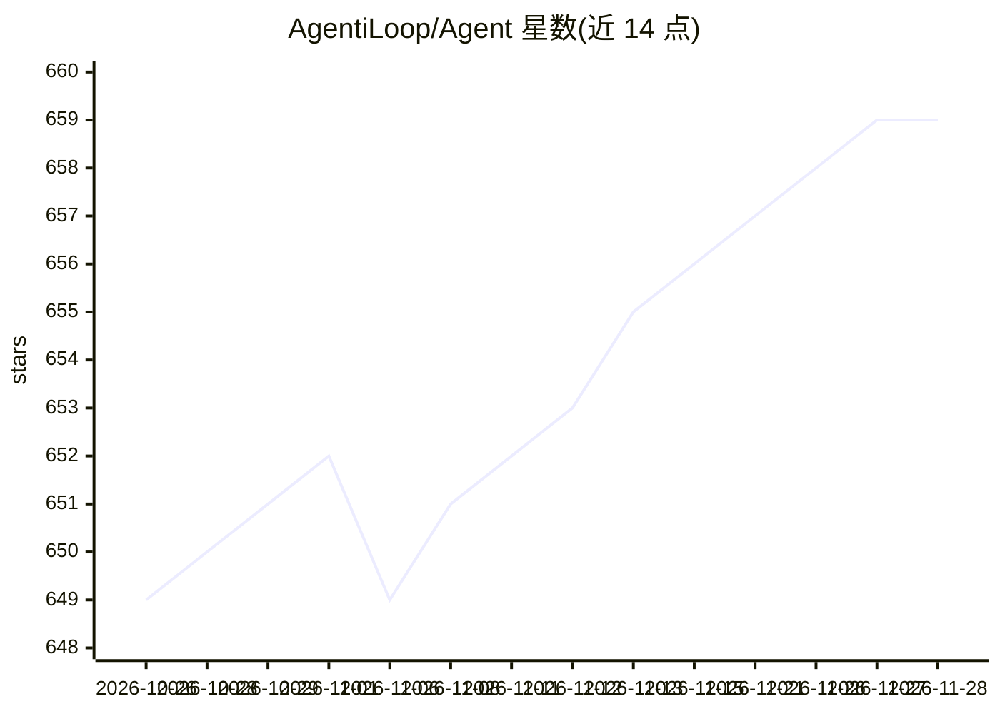

# AgentiLoop/Agent

⭐ 659 · Swift · NOASSERTION · 推送 2026-11-27 · [GitHub](https://github.com/AgentiLoop/Agent) · [官网](https://agentiloop.ai) · 个人维护

**Mac 原生自主 agent：驱动任意应用、写码与自动化执行任务**

基于 Swift 6.4/SwiftUI 的 macOS 原生应用，将 27 个 LLM 提供商（含本地 Ollama/vLLM/LM Studio 与端上 Apple Intelligence）接入自主任务循环：读代码库、改 diff、构建 Xcode 工程、提交 git，经 Accessibility API 与 AppleScript/JXA 驱动任意 Mac 应用，支持用户/root shell、语音唤醒、iMessage 远控、子 agent 与 MCP 扩展。提供签名 `.dmg` 安装包与 Homebrew 安装；从源码构建仅面向开发者，需要 Xcode/Swift 6.4。另有跨平台 Rust/Go CLI 版本。

## 筛选速览

| 维度 | 判定 | 备注 |
|---|---|---|
| AI 角色 | `ai-native` | 本体是模型或模型工具 |
| 许可风险 | `none` | NOASSERTION |
| 部署形态 | `desktop` | 安装包/桌面程序 |
| 模型依赖 | local-ok | 支持本地模型 |
| 硬件要求 | — | 无带数字的原话,不猜 |
| 安装摩擦 | `medium` | 含编译或系统依赖之一 |
| 成熟度 | — | 结构信号不足 |

## 能力要点

- 接入 27 个 LLM 提供商，含本地 Ollama/vLLM/LM Studio 与端上 Apple Intelligence
- 通过 Accessibility API + AppleScript 动态自动化任意 Mac 应用
- 自验证任务循环（goal_state 证据标记）、AgentScript 运行时编译 Swift 脚本
- 语音唤醒、iMessage 远控、最多 3 个并发子 agent 与 MCP 服务器接入

## 适用场景

- 让 agent 读取代码库并修复 bug、构建 Xcode 工程并提交 diff
- 用自然语言或语音操控任意 Mac 应用完成自动化任务
- 完全离线场景下用本地模型驱动 agent
- 通过 iMessage 从 iPhone 远程控制 Mac 上的 agent

## 场景标签

`GUI 自动化` `编码 Agent` `AI 助手` · 领域:效率与自动化

## 证据(README 行号)

> L41: Agent! is a 100% native Swift 6.4 / SwiftUI app that wires **27 LLM providers** — Claude, Codex, OpenAI, Gemini, Gr
> L39: **One app. Any AI. Total command over your Mac.**

## 星数曲线

2026-10-26 649 → 2026-11-28 659（+10）

---
*卡片 v1 · prompt 1.4 · 生成 2026-11-24 · 置信度 high · 依据 README sha `a1f30f8f59bb` · [字段定义](../../DATASET.md)*
