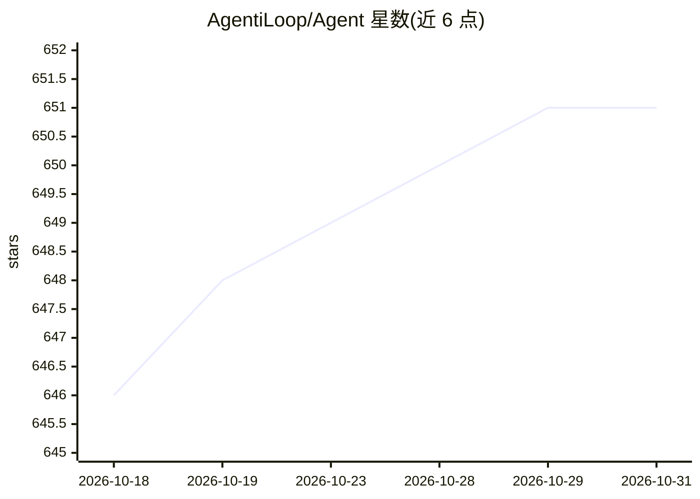

# AgentiLoop/Agent

⭐ 651 · Swift · NOASSERTION · 推送 2026-10-30 · [GitHub](https://github.com/AgentiLoop/Agent) · [官网](https://agentiloop.ai) · 个人维护 · 中文 README

**macOS 原生自主 AI 代理：驱动应用、写码、执行系统任务**

Swift 6.4/SwiftUI 编写的 macOS 桌面 AI 代理应用，接入 23 个 LLM 提供商（云端与本地）及设备端 Apple Intelligence，运行自主任务循环：读写代码库、构建 Xcode 工程、通过 Accessibility API 操控任意 Mac 应用、以用户或 root 身份执行 shell、iMessage 远程控制与语音唤醒，支持 MCP 与子代理。提供签名公证的 .dmg 二进制与 Homebrew 安装，也可从源码构建；需 macOS 14.6+。

## 筛选速览

| 维度 | 判定 | 备注 |
|---|---|---|
| AI 角色 | `ai-native` | 本体是模型或模型工具 |
| 许可风险 | `none` | NOASSERTION |
| 部署形态 | `desktop` | 安装包/桌面程序 |
| 模型依赖 | local-ok | 支持本地模型 |
| 硬件要求 | — | 无带数字的原话,不猜 |
| 安装摩擦 | `medium` | 含编译或系统依赖之一 |
| 成熟度 | — | 结构信号不足 |

## 能力要点

- 接入 23 个 LLM 提供商及设备端 Apple Intelligence
- Accessibility API 驱动任意 Mac 应用，51 个 ScriptingBridge 应用桥接
- 自校验任务循环与编辑快照回滚
- 支持 MCP、最多 3 个并发子代理、Provider 故障自动切换

## 适用场景

- 用自然语言让 AI 代替我操作 Mac 应用和 Xcode 工程
- 在 Mac 上本地或用自带 API key 运行自主编码代理
- 通过 iMessage 或语音远程指派任务

## 场景标签

`GUI 自动化` `编码 Agent` · 领域:效率与自动化

## 证据(README 行号)

> L44: Agent! is a 100% native Swift 6.4 / SwiftUI app that wires **23 LLM providers** — Claude, Codex, OpenAI, Sidrune AI
> L42: **One app. Any AI. Total command over your Mac.**

## 星数曲线

2026-10-18 646 → 2026-10-31 651（+5）

---
*卡片 v1 · prompt 1.4 · 生成 2026-10-22 · 置信度 high · 依据 README sha `9b3c150ef19f` · [字段定义](../../DATASET.md)*
