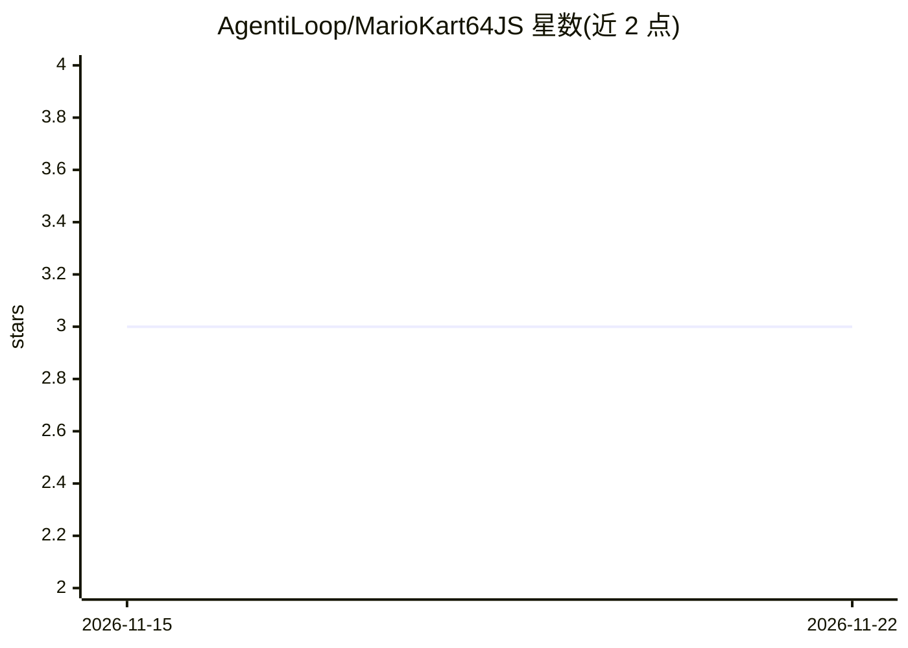

# AgentiLoop/MarioKart64JS

⭐ 3 · JavaScript · 推送 2026-11-20 · [GitHub](https://github.com/AgentiLoop/MarioKart64JS) · [官网](https://mk64js.gokart.games) · 组织维护

**在浏览器中重制 Mario Kart 64 的粉丝研究项目**

将 Mario Kart 64 重制为可在网页浏览器运行的游戏，非模拟器：从用户自备的 N64 ROM 提取赛道、赛车、音乐与音效素材，用 Three.js 重绘渲染。支持 16 条赛道、大奖赛/对战/计时赛模式、四竞技场对战、2-4 人分屏在线联机、15 种道具、Wii 风格 3D 赛车切换与 HD 材质。项目自述为 AI 工具重建经典游戏的测试，属个人与教育用途的研究项目，未完成的进行中状态，素材归 Nintendo 所有。

## 筛选速览

| 维度 | 判定 | 备注 |
|---|---|---|
| AI 角色 | `ai-enhanced` | 去掉 AI 部分产品仍成立 |
| 许可风险 | `none` | — |
| 部署形态 | `library` | 以包/库形式分发 |
| 模型依赖 | — | README 未给出锁定关系 |
| 硬件要求 | — | 无带数字的原话,不猜 |
| 安装摩擦 | `low` | 无编译、无系统依赖或容器化 |
| 成熟度 | `idea` | |

## 能力要点

- 从自备 ROM 提取素材，Three.js 在浏览器重绘渲染，非模拟器
- 16 条赛道、Grand Prix/VS/Time Trials/Battle 模式与 2-4 人在线分屏
- 按 3 键切换 Wii 3D 赛车，支持 240p 至原生分辨率的 HD 材质
- 桌面应用覆盖 Mac、Windows、Linux 与 Raspberry Pi（无 Electron）

## 适用场景

- 在浏览器直接玩重制的 Mario Kart 64
- 与 2-4 人在线分屏联机赛车
- 研究如何从 ROM 提取并重绘游戏素材
- 通过 URL 参数快速进入指定赛道和模式进行测试

## 场景标签

 · 领域:游戏/娱乐

## 证据(README 行号)

> L3: 🤖 **Built by the makers of Agent!**, an autonomous macOS agent. 🌐 agentiloop.ai
> L9: Mario Kart 64, rebuilt to run in a web browser. It isn't an emulator. The courses, karts, music and sounds are pulle
> L12: We built it as a test of how closely AI tools can recreate a classic game, and improve upon it.

## 星数曲线

2026-11-15 3 → 2026-11-22 3（+0）

---
*卡片 v1 · prompt 1.4 · 生成 2026-11-22 · 置信度 high · 依据 README sha `3d72673cbfc1` · [字段定义](../../DATASET.md)*
