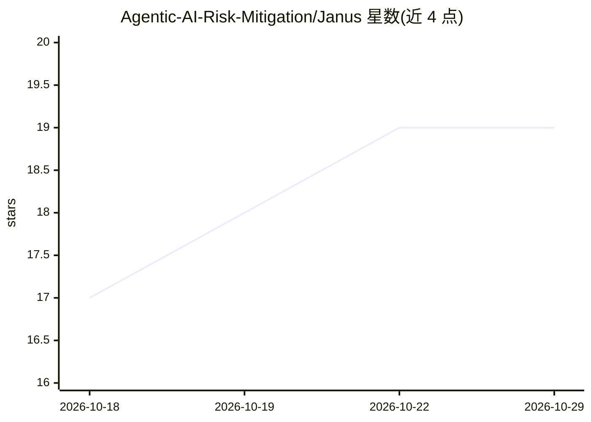

# Agentic-AI-Risk-Mitigation/Janus

⭐ 19 · Python · MIT · 推送 2026-10-07 · [GitHub](https://github.com/Agentic-AI-Risk-Mitigation/Janus) · [官网](https://agentic-ai-risk-mitigation.github.io/Janus/) · 组织维护

**LLM agent 工具调用的策略执行安全层，防御间接提示注入**

面向 LLM agent 的系统级安全库：拦截每一次工具调用，在执行前按 JSON 安全策略（参数级 JSON Schema 条件）校验并放行/阻断，遵循最小权限原则；未匹配规则的调用默认阻断，缺失参数 fail-closed。提供 TaintTracker 记录会话中读取的不可信来源并据此门控外发/改状态类工具，以防御间接提示注入；可选 SpiceDB 支撑的 ReBAC 引擎（PDE）。支持 10+ LLM 提供商（含 Ollama/vLLM 本地）及 LangChain、Google ADK、Claude Agent SDK 框架适配器。Python ≥3.10，经 uv/pip 安装，自述为 Alpha 版本（API 可能变更）。

## 筛选速览

| 维度 | 判定 | 备注 |
|---|---|---|
| AI 角色 | `ai-ecosystem` | LLM/agent 周边工具 |
| 许可风险 | `permissive` | MIT |
| 部署形态 | `library` | 以包/库形式分发 |
| 模型依赖 | local-ok | 支持本地模型 |
| 硬件要求 | — | 无带数字的原话,不猜 |
| 安装摩擦 | `low` | 无编译、无系统依赖或容器化 |
| 成熟度 | `idea` | |

## 能力要点

- 参数级 JSON Schema 策略校验，未匹配规则默认阻断（fail-closed）
- TaintTracker 追踪不可信来源并门控外发工具，防御间接提示注入
- 支持 OpenAI/Anthropic/Gemini/Bedrock/Ollama/vLLM 等 10+ 提供商
- LangChain、Google ADK、Claude Agent SDK（含 Claude Code CLI 钩子）适配器

## 适用场景

- 给 agent 的工具调用加最小权限策略，阻断越权操作
- 防止 agent 读取不可信网页后执行注入指令（如外发数据）
- 在任意 agent 框架中独立嵌入 PolicyEnforcer 作为工具调用闸门

## 场景标签

`网络安全` · 领域:学习与行业

## 证据(README 行号)

> L3: **System-level security for LLM agents via fine-grained policy enforcement on tool calls.**
> L5: Janus intercepts every tool call an LLM agent makes and validates it against a security policy before execution — fo

## 星数曲线

2026-10-18 17 → 2026-10-29 19（+2）

---
*卡片 v1 · prompt 1.4 · 生成 2026-10-29 · 置信度 high · 依据 README sha `c2030c66d63c` · [字段定义](../../DATASET.md)*
