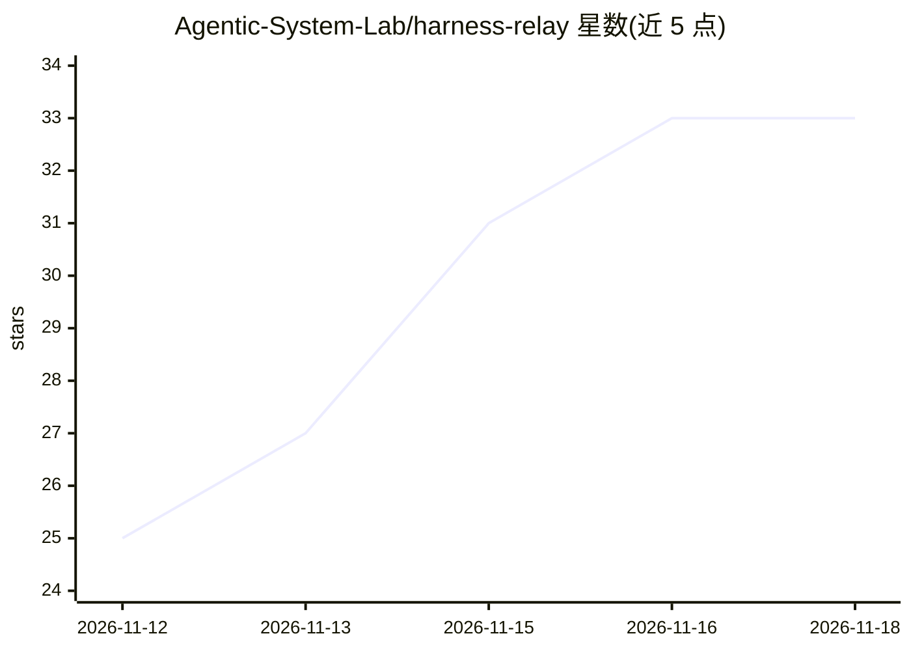

# Agentic-System-Lab/harness-relay

⭐ 33 · TypeScript · NOASSERTION · 推送 2026-11-17 · [GitHub](https://github.com/Agentic-System-Lab/harness-relay) · [官网](https://agentic-system-lab.github.io/harness-relay/) · 组织维护 · 中文 README

**本地多 coding agent 协作任务助手：12 种 agent 组队答问改码**

本地优先的任务助手：把 Claude Code、Codex、Grok、Cursor、Copilot 等闭源 CLI 与 OpenCode、Goose、Cline、OpenHands、Pi 五个开源 coding agent 组成一个团队。主管 agent 按问题从模板挑选或设计团队（角色、模型、轮次），用户确认后运行各 CLI，消息汇入同一聊天。支持圆桌/并行/接力与 @提及、git worktree 并行改码、按聊天分级权限与 OS 沙箱、自动化定时任务、MCP 工具库（浏览器/邮件/日历）。数据存于单个 SQLite 文件，服务绑定 127.0.0.1，提供桌面应用与繁体中文界面。需 Node.js 22.13+、Git 及至少一个 agent CLI。

## 筛选速览

| 维度 | 判定 | 备注 |
|---|---|---|
| AI 角色 | `ai-ecosystem` | LLM/agent 周边工具 |
| 许可风险 | `none` | NOASSERTION |
| 部署形态 | `library` | 以包/库形式分发 |
| 模型依赖 | local-ok | 支持本地模型 |
| 硬件要求 | — | 无带数字的原话,不猜 |
| 安装摩擦 | `low` | 无编译、无系统依赖或容器化 |
| 成熟度 | — | 结构信号不足 |

## 能力要点

- 12 种 coding agent（7 闭源 CLI + 5 开源）混合组队，开源 agent 可用 API key 或自建 OpenAI 兼容后端（vLLM/Ollama/LM Studio/llama.cpp）
- 主管 agent 为每个问题设计团队并供用户确认，团队回答后 lead review 标注需关注之处
- 每聊天分级权限（只读/编辑/完全）配合各 CLI 沙箱与自建沙箱，git worktree 并行模式
- 本地优先：单 SQLite 文件、127.0.0.1 服务、桌面应用（macOS Apple Silicon/Windows/Linux）、Tailscale 手机访问

## 适用场景

- 让多个 coding agent 并行修 bug、对比 diff 后择优合入
- 组队做技术调研与文档撰写（如接力式 release notes）
- 定时自动化：每早读邮件日历生成简报，追踪跨天目标

## 场景标签

`多智能体` `编码 Agent` `AI 助手` · 领域:Agent 开发

## 证据(README 行号)

> L13: A local task assistant: the real **Claude Code, Codex, Grok, Cursor, Antigravity, Copilot and Muse Code** CLIs, and
> L15: For each question, a lead agent picks the team from your templates (or adapts one, or designs a new one), and you c

## 星数曲线

2026-11-12 25 → 2026-11-18 33（+8）

---
*卡片 v1 · prompt 1.4 · 生成 2026-11-18 · 置信度 high · 依据 README sha `bb8d76f28d0f` · [字段定义](../../DATASET.md)*
