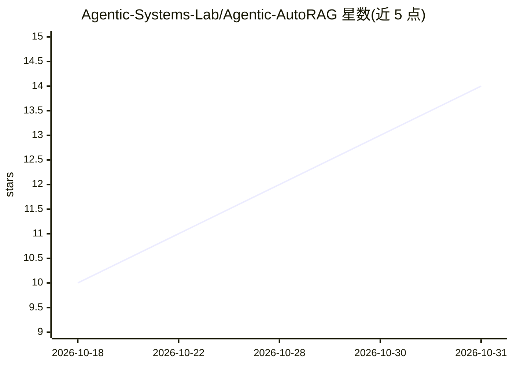

# Agentic-Systems-Lab/Agentic-AutoRAG

⭐ 14 · Python · MIT · 推送 2026-10-21 · [GitHub](https://github.com/Agentic-Systems-Lab/Agentic-AutoRAG) · [官网](https://arxiv.org/abs/2610.08452) · 组织维护

**LLM agent 驱动的 RAG 流水线配置优化器**

面向 RAG 系统构建者的调优工具：用户提供语料与搜索空间（分块、嵌入、检索、重排、生成等选项），LLM agent 从语料生成基于原文的考试题，逐次构建流水线并评分；诊断 agent 解释失败原因，提议 agent 据此选择下一配置，最终输出推荐配置与准确率-成本的 Pareto 前沿。模型经由 LiteLLM 接入，支持 OpenAI/Anthropic/Gemini/Bedrock 等以及 Ollama/vLLM 本地运行时。Python 3.12+，用 uv 安装运行，配置 YAML 驱动，MIT 许可。

## 筛选速览

| 维度 | 判定 | 备注 |
|---|---|---|
| AI 角色 | `ai-ecosystem` | LLM/agent 周边工具 |
| 许可风险 | `permissive` | MIT |
| 部署形态 | `None` |  |
| 模型依赖 | local-ok | 支持本地模型 |
| 硬件要求 | — | 无带数字的原话,不猜 |
| 安装摩擦 | `low` | 无编译、无系统依赖或容器化 |
| 成熟度 | — | 结构信号不足 |

## 能力要点

- 从语料自动生成基于原文span的类型化考试并缓存复用
- 诊断-提议循环驱动的配置搜索
- 输出准确率-成本 Pareto 前沿与推荐配置 YAML
- 通过 LiteLLM 支持多提供商及 Ollama/vLLM 本地模型

## 适用场景

- 为自己的文档语料自动调优 RAG 流水线配置
- 在回答准确率与每查询成本之间权衡选型
- 复现论文实验或基于自定义问题集优化

## 场景标签

`RAG` `模型评测` · 领域:评测与运维

## 证据(README 行号)

> L9: Agentic AutoRAG tunes a Retrieval-Augmented Generation (RAG) pipeline for your documents. You give it a corpus and a
> L11: LLM agents run the search. Each trial builds one pipeline and scores it on an exam that the tool writes from your c

## 星数曲线

2026-10-18 10 → 2026-10-31 14（+4）

---
*卡片 v1 · prompt 1.4 · 生成 2026-10-31 · 置信度 high · 依据 README sha `333835a44b15` · [字段定义](../../DATASET.md)*
