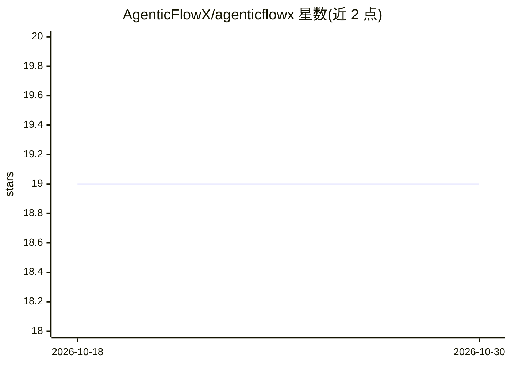

# AgenticFlowX/agenticflowx

⭐ 19 · TypeScript · NOASSERTION · 推送 2026-10-20 · [GitHub](https://github.com/AgenticFlowX/agenticflowx) · [官网](https://agenticflowx.github.io) · 组织维护

**给 AI 编程者的 VS Code 扩展：聊天优先，按需升级为规格驱动开发**

VS Code 扩展，作为侧边栏 AI 编程助手运行：支持聊天、文件上下文、右键编辑器操作、模型切换与图片附件。当任务需要留痕时，可进入 Spec 模式进行规格驱动开发：以 spec/design/tasks/journal 四类 markdown 文件承载需求、设计、任务与工作会话，提供 Dash/Sprint/Full spec 三档结构、稳定 ID 与 @see 回链、审批门与追溯。另有 Previewer、SDD Studio、Workbench、JSON Canvas 画布等功能，项目状态存于仓库内 markdown 而非外部数据库。通过 VS Code Marketplace/Open VSX 安装，支持多类 VS Code 兼容编辑器。

## 筛选速览

| 维度 | 判定 | 备注 |
|---|---|---|
| AI 角色 | `ai-ecosystem` | LLM/agent 周边工具 |
| 许可风险 | `none` | NOASSERTION |
| 部署形态 | `None` |  |
| 模型依赖 | — | README 未给出锁定关系 |
| 硬件要求 | — | 无带数字的原话,不猜 |
| 安装摩擦 | `low` | 无编译、无系统依赖或容器化 |
| 成熟度 | — | 结构信号不足 |

## 能力要点

- Code/Explore/Spec 三模式共用一个聊天框，Explore 为强制只读
- Dash/Sprint/Full spec 三档 SDD 结构，含稳定需求 ID、审批门与 @see 追溯
- 项目状态存于仓库内 markdown 与 JSON Canvas，无外部数据库
- Workbench 提供 Pipeline/Documents/Analytics/Board/Notes/Journal 视图

## 适用场景

- 在 VS Code 内用 AI 聊天完成日常编码与代码审查
- 为需要留痕的功能走规格驱动流程：需求→设计→任务→审批
- 用看板、分析与会话日志追踪多功能项目的进度与证据

## 场景标签

`AI 助手` `代码审查` · 领域:编码与开发

## 证据(README 行号)

> L25: AgenticFlowX is a VS Code extension for AI coding that starts as a normal chat assistant and grows structure only w
> L67: When the selected model supports image input, the composer can attach screenshots and diagrams to a turn (including

## 星数曲线

2026-10-18 19 → 2026-10-30 19（+0）

---
*卡片 v1 · prompt 1.4 · 生成 2026-10-29 · 置信度 high · 依据 README sha `e4b4023ad91f` · [字段定义](../../DATASET.md)*
