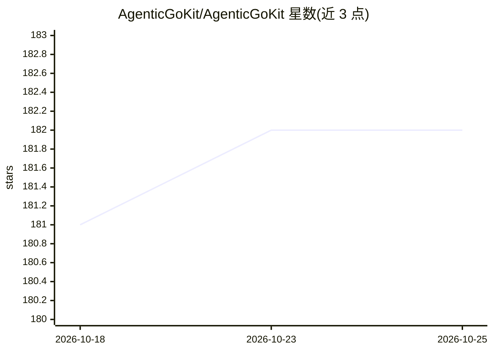

# AgenticGoKit/AgenticGoKit

⭐ 182 · Go · Apache-2.0 · 推送 2026-08-01 · [GitHub](https://github.com/AgenticGoKit/AgenticGoKit) · [官网](https://docs.agenticgokit.com/) · 组织维护

**Go 语言多智能体 AI 应用开发框架**

用 Go 编写智能体系统的框架：提供流式优先的 v1beta API，支持单智能体到顺序/并行/DAG/循环的多智能体工作流编排，内置记忆与 RAG（默认 chromem 嵌入式向量库，可换 pgvector），支持图像/音频/视频多模态输入，通过 MCP 协议做工具动态发现，内置 OpenTelemetry 分布式追踪。面向希望在 Go 技术栈内构建和部署 agent 的开发者；处于 Beta 阶段，v1.0 将移除 legacy core 包。配套 AGK CLI 与模板仓库构成三件套生态。Apache 2.0 许可。

## 筛选速览

| 维度 | 判定 | 备注 |
|---|---|---|
| AI 角色 | `ai-ecosystem` | LLM/agent 周边工具 |
| 许可风险 | `permissive` | Apache-2.0 |
| 部署形态 | `library` | 以包/库形式分发 |
| 模型依赖 | local-ok | 支持本地模型 |
| 硬件要求 | — | 无带数字的原话,不猜 |
| 安装摩擦 | `low` | 无编译、无系统依赖或容器化 |
| 成熟度 | `idea` | |

## 能力要点

- 顺序/并行/DAG/循环/SubWorkflow 多智能体编排模式
- 内置记忆与 RAG，默认 chromem 向量库可换 pgvector
- MCP 协议工具动态发现与注册
- 内置 OpenTelemetry 分布式追踪，单环境变量开启

## 适用场景

- 在 Go 项目中构建多智能体工作流应用
- 本地用 Ollama 或 vLLM 做隐私优先/高吞吐推理开发
- 为 agent 系统接入可观测性与追踪

## 场景标签

`多智能体` `RAG` `Agent 记忆` · 领域:Agent 开发

## 证据(README 行号)

> L10: **Robust Go framework for building intelligent multi-agent AI systems**
> L18: **The most productive way to build AI agents in Go.** AgenticGoKit provides a unified, streaming-first API for crea

## 星数曲线

2026-10-18 181 → 2026-10-25 182（+1）

---
*卡片 v1 · prompt 1.4 · 生成 2026-10-22 · 置信度 high · 依据 README sha `6a9ec0541682` · [字段定义](../../DATASET.md)*
