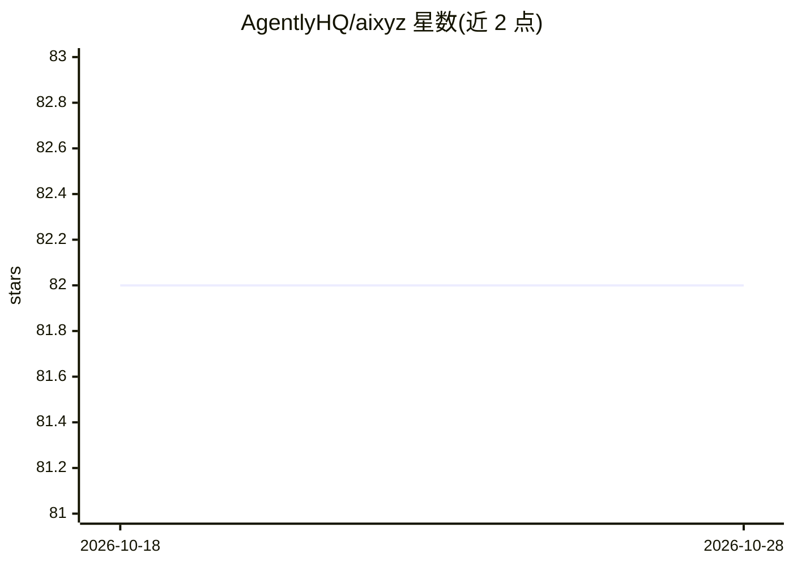

# AgentlyHQ/aixyz

⭐ 82 · TypeScript · 推送 2026-07-17 · [GitHub](https://github.com/AgentlyHQ/aixyz) · [官网](https://aixyz.sh) · 组织维护

**构建可部署 AI Agent 服务的 Next.js 式框架，内置支付与链上身份**

TypeScript 框架，将 AI Agent 打包为可部署服务：开发者用配置文件声明 Agent 身份与收款地址、用 Vercel AI SDK 定义 Agent 与工具、通过 bun run dev 一键启动后自动生成服务器并接入 A2A、MCP、x402 与 ERC-8004 协议。内置 CLI 支持 dev/build 与链上身份注册，可构建 standalone、Vercel 或可执行文件产物；提供 11 个示例工程，含本地 LLM、Stripe 支付、子 Agent 等。MIT 许可。

## 筛选速览

| 维度 | 判定 | 备注 |
|---|---|---|
| AI 角色 | `ai-ecosystem` | LLM/agent 周边工具 |
| 许可风险 | `none` | — |
| 部署形态 | `None` |  |
| 模型依赖 | — | README 未给出锁定关系 |
| 硬件要求 | — | 无带数字的原话,不猜 |
| 安装摩擦 | `low` | 无编译、无系统依赖或容器化 |
| 成熟度 | — | 结构信号不足 |

## 能力要点

- 自动生成服务器并接线 A2A + MCP + x402
- x402 按请求微支付，链上验证
- ERC-8004 链上 Agent 身份注册（Ethereum/Base/Polygon 等 7 条链）
- CLI 支持 standalone/Vercel/可执行文件三种构建产物

## 适用场景

- 把 AI Agent 发布为带按次付费能力的服务
- 通过 MCP 向 Claude Desktop 等客户端共享工具
- 为 Agent 注册链上身份供其他 Agent 发现与调用

## 场景标签

`Agent 框架` · 领域:Agent 开发

## 证据(README 行号)

> L3:  Nextjs-like framework for bundling AI agents into deployable services with A2A, MCP, x402 payments, and ERC-8004 id
> L75: That's it. Run `bun run dev` and aixyz auto-generates the server, wires up A2A + MCP + x402, and starts serving.

## 星数曲线

2026-10-18 82 → 2026-10-28 82（+0）

---
*卡片 v1 · prompt 1.4 · 生成 2026-10-24 · 置信度 high · 依据 README sha `b8ae8dd481dd` · [字段定义](../../DATASET.md)*
