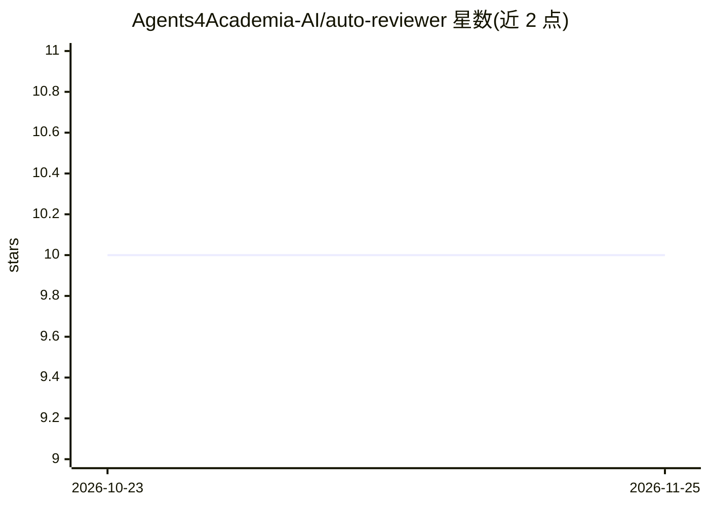

# Agents4Academia-AI/auto-reviewer

⭐ 10 · Python · MIT · 推送 2026-07-09 · [GitHub](https://github.com/Agents4Academia-AI/auto-reviewer) · 组织维护

**将论文 PDF 自动转化为结构化审稿意见的 agent 流水线**

基于 Claude API 的深度学习论文自动审稿 agent，按 10 阶段流水线处理 PDF：每阶段以缓存文档块传入原始 PDF（含图表、公式与版面视觉信息），生成声明/证据图谱、新颖性与严谨性检查，并带自评环节；输出 JSON 全量记录与面向作者的 Markdown 审稿。另含 FastAPI web 层加独立 worker 进程的上传网站（SQLite 存储、页数/大小/队列上限、可选共享密码）。帮助作者改进论文，非正式评审替代。各阶段串行执行，无并行。

## 筛选速览

| 维度 | 判定 | 备注 |
|---|---|---|
| AI 角色 | `ai-native` | 本体是模型或模型工具 |
| 许可风险 | `permissive` | MIT |
| 部署形态 | `library` | 以包/库形式分发 |
| 模型依赖 | locked-api |  |
| 硬件要求 | — | 无带数字的原话,不猜 |
| 安装摩擦 | `low` | 无编译、无系统依赖或容器化 |
| 成熟度 | — | 结构信号不足 |

## 能力要点

- 10 阶段流水线：声明/证据映射、新颖性与严谨性检查、自评环节
- PDF 以缓存文档块传入，模型可读文本与页面级视觉信息（图表/公式/版面）
- Web 版上传界面实时展示 10 阶段进度，FastAPI + worker 双进程共享 SQLite
- 输出含 token 用量的 JSON 与面向作者的 Markdown 审稿

## 适用场景

- 论文投稿前获取结构化反馈以改进稿件
- 为研究团队批量预审 PDF 论文并留存 JSON 记录
- 自部署网站供多人上传论文并查看审稿进度

## 场景标签

`科研工具` `文档解析` · 领域:知识与检索

## 证据(README 行号)

> L3: An automated reviewing agent for deep learning papers based on the Claude API. It follows the 10-stage workflow defi
> L9: Each stage passes the original PDF to the model as a **cached document block**. The model can use both the text cont

## 星数曲线

2026-10-23 10 → 2026-11-25 10（+0）

---
*卡片 v1 · prompt 1.4 · 生成 2026-11-20 · 置信度 high · 依据 README sha `70e53eb8454a` · [字段定义](../../DATASET.md)*
