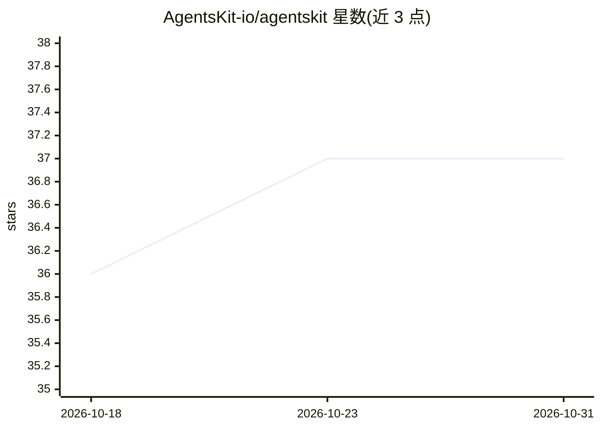

# AgentsKit-io/agentskit

⭐ 37 · TypeScript · MIT · 推送 2026-10-30 · [GitHub](https://github.com/AgentsKit-io/agentskit) · [官网](https://www.agentskit.io/) · 个人维护

**给 JS 开发者的 AI agent 构建工具包：24 个可组合包，从聊天 UI 到自主 agent**

JavaScript/TypeScript 的 AI agent 工具集，由 24 个独立可用的 npm 包组成：零依赖的 10KB 核心、25 个原生 provider 适配器（OpenAI/Anthropic/Gemini/Ollama/DeepSeek/Grok 等）、自主运行时（ReAct 循环、多 agent 委派）、工具、技能、记忆、RAG、评测与可观测层，并提供 React/Vue/Svelte/Solid/Angular/React Native/终端 UI 绑定。六个 ADR 形式化契约定死各接口，provider 一行切换。仅 core 包为 v1 稳定版，其余包处于独立 beta 轨道。快速开始无需 API key 即可运行。

## 筛选速览

| 维度 | 判定 | 备注 |
|---|---|---|
| AI 角色 | `ai-ecosystem` | LLM/agent 周边工具 |
| 许可风险 | `permissive` | MIT |
| 部署形态 | `library` | 以包/库形式分发 |
| 模型依赖 | local-ok | 支持本地模型 |
| 硬件要求 | — | 无带数字的原话,不猜 |
| 安装摩擦 | `low` | 无编译、无系统依赖或容器化 |
| 成熟度 | `idea` | |

## 能力要点

- 24 个独立可组合的包，核心零依赖且 CI 强制 10KB gzip 预算
- 六个 ADR 形式化契约使 adapter/tool/skill/memory/runtime 可替换
- 7 个框架绑定（React/Vue/Svelte/Solid/Angular/RN/Ink 终端）
- Quick start 无需账号、API key 或网络请求即可运行

## 适用场景

- 用 React 或终端快速搭一个带工具调用的流式聊天界面
- 构建无 UI 的自主 agent 并做多 agent 委派
- 用一套代码在 OpenAI/Anthropic/Ollama 等 provider 间一行切换
- 通过 MCP 包把自建工具暴露给 Claude Desktop/Cursor

## 场景标签

`Agent 框架` `多智能体` · 领域:Agent 开发

## 证据(README 行号)

> L60: |**AgentsKit**|**This repo**|The agent building blocks: adapters, runtime, tools, memory, RAG, UI, evals, observabi
> L155: |`@agentskit/adapters`|Provider adapters (OpenAI, Anthropic, Gemini, Ollama, DeepSeek, Grok, …)|beta|

## 星数曲线

2026-10-18 36 → 2026-10-31 37（+1）

---
*卡片 v1 · prompt 1.4 · 生成 2026-10-25 · 置信度 high · 依据 README sha `211c2fbdcbf8` · [字段定义](../../DATASET.md)*
