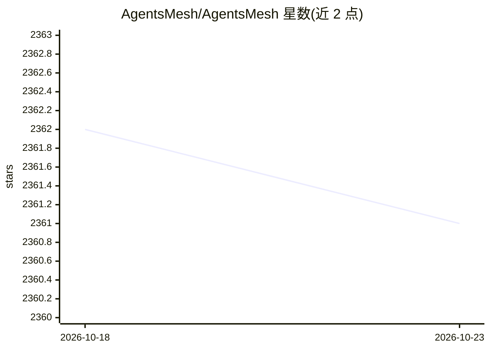

# AgentsMesh/AgentsMesh

⭐ 2,361 · Go · NOASSERTION · 推送 2026-09-23 · [GitHub](https://github.com/AgentsMesh/AgentsMesh) · [官网](https://agentsmesh.ai) · 组织维护

**自托管 AI Agent 编排平台：跨自有机器调度、隔离并管理上百个编码 agent**

面向团队运行大规模终端 AI 编码 agent 的控制平面：自托管 Runner 守护进程安装在自己的机器上组成机群，agent 以 AgentPod 形式在独立 PTY 与 Git worktree 沙箱中运行，代码留在本地基础设施。后端为 Go（gRPC+mTLS 控制面 + WebSocket Relay 数据面），Web/Electron/SiOS 客户端共享 Rust 核心。提供 Autopilot 控制代理、Mesh/Channel 协作、Kanban 工单与 BYOK 托管服务；内置支持 Claude Code、Codex CLI、Gemini CLI、Aider 等任意终端 agent。采用 BSL-1.1 许可证。

## 筛选速览

| 维度 | 判定 | 备注 |
|---|---|---|
| AI 角色 | `ai-ecosystem` | LLM/agent 周边工具 |
| 许可风险 | `none` | NOASSERTION |
| 部署形态 | `None` |  |
| 模型依赖 | — | README 未给出锁定关系 |
| 硬件要求 | — | 无带数字的原话,不猜 |
| 安装摩擦 | `low` | 无编译、无系统依赖或容器化 |
| 成熟度 | — | 结构信号不足 |

## 能力要点

- Runner 机群调度，agent 在各机器的隔离 Git worktree 沙箱 pod 中执行
- Autopilot 控制代理：idle 自动下发指令、迭代上限、人工接管
- Web/Electron/iOS 客户端共享同一 Rust 核心（WASM/UniFFI）
- 内置支持 Claude Code、Codex CLI、Gemini CLI、Aider 及任意终端 agent

## 适用场景

- 在自己服务器上并行运行几十上百个 AI 编码 agent
- 统一控制台监控多个 agent 的实时终端与工单进度
- 让多个 agent 通过 Mesh/Channel 协作完成团队级任务

## 场景标签

`多智能体` `编码 Agent` · 领域:Agent 开发

## 证据(README 行号)

> L6:  Run a hundred AI agents across your own machines — and command them all from one console.
> L35: What's missing isn't the agent. It's the **control layer** that turns one operator into the director of an agent wo
> L56: - **Runner** — a self-hosted daemon you install on your own machines. It connects to the backend over gRPC+mTLS and

## 星数曲线

2026-10-18 2,362 → 2026-10-23 2,361（-1）

---
*卡片 v1 · prompt 1.4 · 生成 2026-10-21 · 置信度 high · 依据 README sha `748b10dc30be` · [字段定义](../../DATASET.md)*
