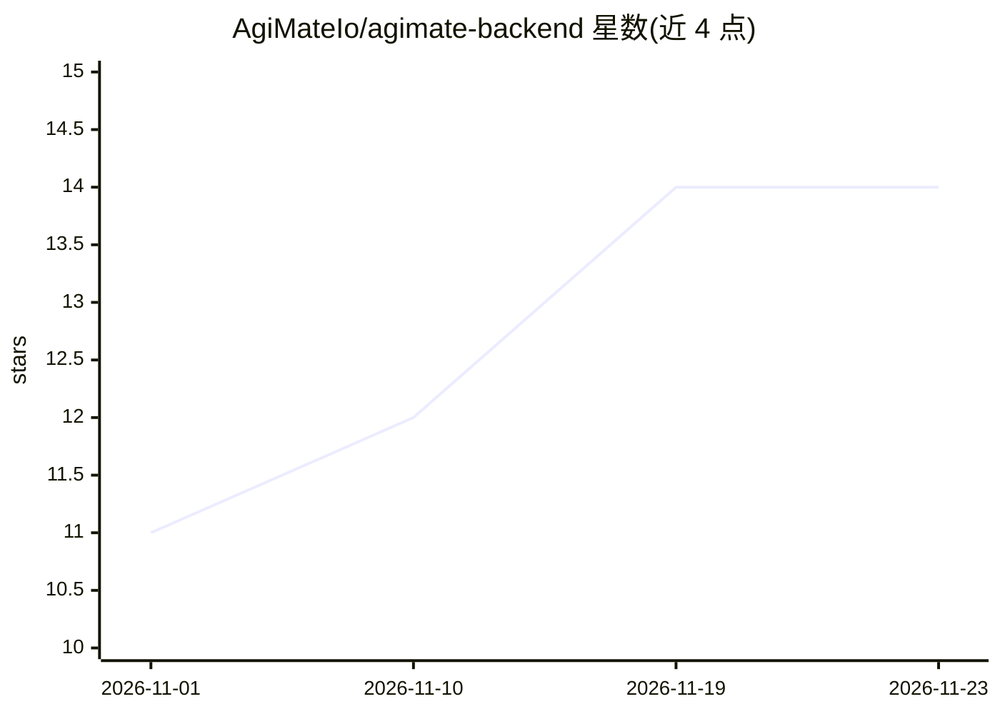

# AgiMateIo/agimate-backend

⭐ 14 · Java · NOASSERTION · 推送 2026-11-19 · [GitHub](https://github.com/AgiMateIo/agimate-backend) · [官网](https://agimate.io) · 组织维护 · 中文 README

**自托管多 agent 平台后端：凭证不出平台、出站调用逐次校验留痕**

AgiMate 平台的后端服务，按 Gradle 多模块组织：user-api 提供账户与 OAuth2/JWT，control-api 管理 agent、连接器、触发器并暴露 gRPC 与 ACP WebSocket 端点，agent-worker 以无头 agent 循环驱动对话。平台强制执行的护栏包括：连接需显式绑定 agent、工具输出按不可信数据包裹、出站请求仅限公网地址、凭证以 AES-256-GCM 加密且 LLM 密钥不交给外部 agent、全部调用留日志、运行可中途取消。依赖 JDK 25、PostgreSQL、Centrifugo，文档大部分为俄文，许可证为 FSL-1.1-ALv2。

## 筛选速览

| 维度 | 判定 | 备注 |
|---|---|---|
| AI 角色 | `ai-ecosystem` | LLM/agent 周边工具 |
| 许可风险 | `none` | NOASSERTION |
| 部署形态 | `self-host` | docker 或自建部署 |
| 模型依赖 | — | README 未给出锁定关系 |
| 硬件要求 | — | 无带数字的原话,不猜 |
| 安装摩擦 | `low` | 无编译、无系统依赖或容器化 |
| 成熟度 | — | 结构信号不足 |

## 能力要点

- 护栏由平台强制而非模型判断：绑定准入、工具输出包裹、出站公网校验
- 凭证 AES-256-GCM 加密，LLM 密钥不出平台，外部 agent 用自有密钥运行
- 每次运行、触发、工具调用与 webhook 均按 agent/用户记录日志
- gRPC + ACP WebSocket 协议，配套前端、Android 客户端与 n8n 节点

## 适用场景

- 在自己服务器上用自有密钥运行多个协作 AI agent
- 让 agent 访问真实基础设施与凭证的同时控制可触达范围
- 对 agent 的工具调用与外发请求做审计与中途终止

## 场景标签

`Agent 框架` `多智能体` · 领域:Agent 开发

## 证据(README 行号)

> L5: Backend services for AgiMate — a platform where specialized AI agents work
> L19: |`control-api`|Agents, skills, connectors, channels and triggers, boards, LLM providers. Also serves the agent-work
> L56: An agent in this system works with live credentials against real infrastructure. The guardrails

## 星数曲线

2026-11-01 11 → 2026-11-23 14（+3）

---
*卡片 v1 · prompt 1.4 · 生成 2026-11-18 · 置信度 high · 依据 README sha `f5ee6fa6b5ca` · [字段定义](../../DATASET.md)*
