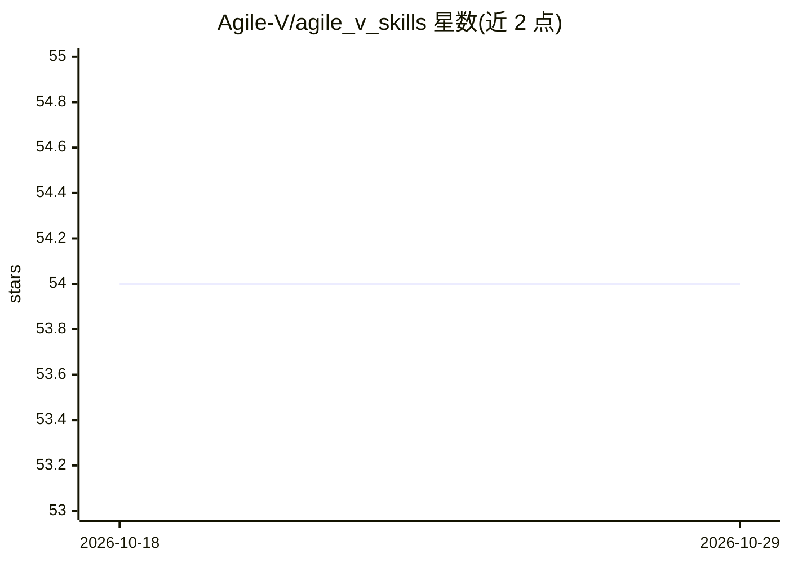

# Agile-V/agile_v_skills

⭐ 54 · Python · CC-BY-SA-4.0 · 推送 2026-10-05 · [GitHub](https://github.com/Agile-V/agile_v_skills) · [官网](https://agile-v.org/) · 组织维护

**给 AI 辅助工程提供可审计保障层的 agent 技能库（49 个技能）**

工具无关、人工治理的 AI 工程保障层：以 Agent Skills 形式提供 49 个技能与 40 个证据 schema，覆盖需求固化、独立测试设计、独立验证（red-team-verifier）、人工审批门（Human Gates）、L0-L4 风险分级与类型化溯源，支持 Python/JS/NestJS/Dart/嵌入式 C++ 五个构建域。安装方式为 git clone 后复制技能目录到各平台 skills 目录，或使用 Agent Plugins 1.0 发布包；支持 Claude Code、Cursor、VS Code、GitHub Copilot。合规映射（ISO 9001/27001、GxP）声明为设计阶段对齐，且明确不构成认证或监管批准。

## 筛选速览

| 维度 | 判定 | 备注 |
|---|---|---|
| AI 角色 | `ai-ecosystem` | LLM/agent 周边工具 |
| 许可风险 | `viral` | CC-BY-SA-4.0 |
| 部署形态 | `None` |  |
| 模型依赖 | — | README 未给出锁定关系 |
| 硬件要求 | — | 无带数字的原话,不猜 |
| 安装摩擦 | `low` | 无编译、无系统依赖或容器化 |
| 成熟度 | `idea` | |

## 能力要点

- 49 个技能 + 40 个证据 schema + 可执行契约测试套件（pytest）
- Human Gates 人工审批与 L0-L4 风险分级控制
- 独立验证角色（red-team-verifier）与类型化需求-产物-测试溯源
- 15 个 digest-pinned 证据适配器（pytest/GitHub Actions/SonarQube 等，均为 candidate/experimental）

## 适用场景

- 让 AI 编码代理在受审需求基线上实现并留下可检查证据链
- 受监管或有安全风险的工程中做人工审批门与合规留痕
- 多代理/多会话协作时维持稳定基线与可复现交接

## 场景标签

`提示工程` · 领域:Agent 开发

## 证据(README 行号)

> L3: **Open Agent Skills for turning AI-assisted engineering into a reviewable chain from approved requirements to implem
> L18: Agile V is a tool-agnostic, human-governed assurance layer for AI-assisted engineering. It gives agents explicit ro
> L76: |**49 skills**|Machine-readable `catalog/skills.json` and the Skill Routing Guide|

## 星数曲线

2026-10-18 54 → 2026-10-29 54（+0）

---
*卡片 v1 · prompt 1.4 · 生成 2026-10-24 · 置信度 high · 依据 README sha `f63f587d2eb4` · [字段定义](../../DATASET.md)*
