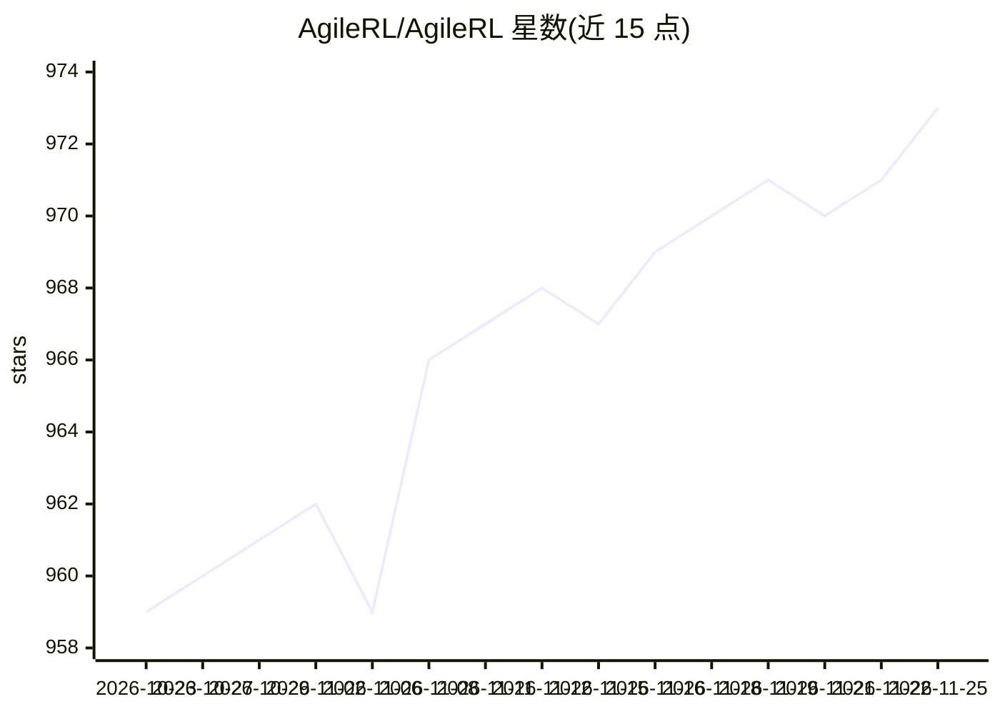

# AgileRL/AgileRL

⭐ 973 · Python · Apache-2.0 · 推送 2026-11-24 · [GitHub](https://github.com/AgileRL/AgileRL) · [官网](https://agilerl.com) · 组织维护

**LLM 后训练与强化学习训练库：SFT/DPO/多轮 agentic RL 一体化**

一个覆盖 LLM 后训练全流程与经典深度 RL 的 Python 库：从监督微调（SFT）、偏好优化（DPO）到多轮 agentic RL（GRPO/CISPO/GSPO/PPO/REINFORCE），内置进化式超参数优化；同时支持单智能体、多智能体、离线 RL 与上下文多臂老虎机。支持 LoRA/QLoRA、torchrun 并行（数据并行/FSDP2）、vLLM 快速 rollout，训练通过 YAML manifest 或 Python API 发起。面向需要训练和部署模型的研究者与开发者。

## 筛选速览

| 维度 | 判定 | 备注 |
|---|---|---|
| AI 角色 | `ai-ecosystem` | LLM/agent 周边工具 |
| 许可风险 | `permissive` | Apache-2.0 |
| 部署形态 | `library` | 以包/库形式分发 |
| 模型依赖 | local-ok | 支持本地模型 |
| 硬件要求 | `cpu-ok` | |
| 安装摩擦 | `medium` | 含编译或系统依赖之一 |
| 成熟度 | — | 结构信号不足 |

## 能力要点

- LLM 后训练全流程：SFT、DPO 及五种 RL 算法（GRPO/CISPO/GSPO/PPO/REINFORCE）
- 进化式 HPO 在单次训练中自我调节学习率、KL 惩罚等超参数
- torchrun 启动的数据并行/FSDP2 分布式训练，vLLM 生成 rollout
- 训练流程以 YAML manifest 表达，可由编码 agent 自行校验并提交运行

## 适用场景

- 对开源权重 LLM 做多轮 agentic RL 后训练
- 用进化式 HPO 替代多次网格/贝叶斯调参试验
- 在 Gymnasium/PettingZoo 环境上训练单/多智能体策略
- 训练后部署 checkpoint 并通过 CLI 对话验证

## 场景标签

`强化学习` `微调` `多智能体` · 领域:Agent 开发

## 证据(README 行号)

> L13: AgileRL takes an open-weights LLM from supervised fine-tuning through preference tuning to multi-turn agentic RL, i
> L19: - **The whole pipeline.** SFT and DPO, then RL with GRPO, CISPO, GSPO, REINFORCE or PPO.
> L22: - **Torch-native parallelism.** Data parallel or FSDP2 sharding, launched with `torchrun`. One `FSDPConfig` works f

## 星数曲线

2026-10-23 959 → 2026-11-25 973（+14）

---
*卡片 v1 · prompt 1.4 · 生成 2026-11-24 · 置信度 high · 依据 README sha `a0cd2921b8f0` · [字段定义](../../DATASET.md)*
