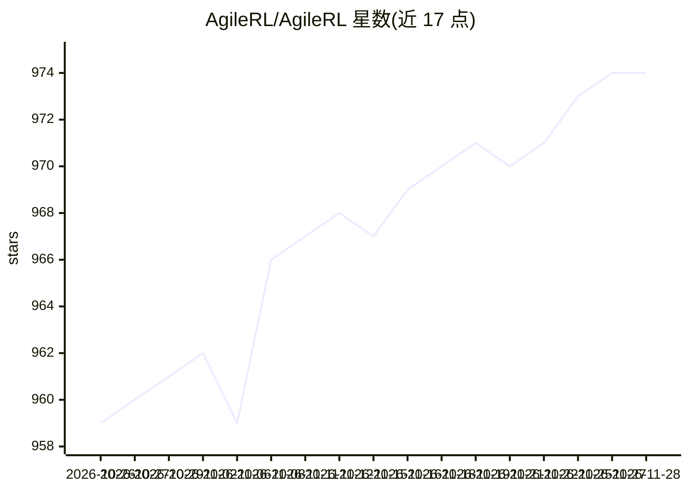

# AgileRL/AgileRL

⭐ 974 · Python · Apache-2.0 · 推送 2026-11-27 · [GitHub](https://github.com/AgileRL/AgileRL) · [官网](https://agilerl.com) · 组织维护

**LLM 后训练平台 Arena 的 CLI 与 Python SDK**

agilerl 是 AgileRL 后训练平台 Arena 的命令行工具与 Python SDK：将开放权重 LLM/VLM 经 SFT、偏好微调、教师模型蒸馏、单轮与多轮强化学习训练为任务专用 agent，并部署推理。用户以 YAML manifest 描述实验并经 git 管理，平台自动决定训练配置与 GPU 资源，支持上传自有数据集与 Python 环境代码（兼容 OpenEnv reset/step API）。需登录平台使用，训练在平台 GPU 或用户自有集群上进行。

## 筛选速览

| 维度 | 判定 | 备注 |
|---|---|---|
| AI 角色 | `ai-ecosystem` | LLM/agent 周边工具 |
| 许可风险 | `permissive` | Apache-2.0 |
| 部署形态 | `library` | 以包/库形式分发 |
| 模型依赖 | — | README 未给出锁定关系 |
| 硬件要求 | — | 无带数字的原话,不猜 |
| 安装摩擦 | `low` | 无编译、无系统依赖或容器化 |
| 成熟度 | — | 结构信号不足 |

## 能力要点

- 覆盖 SFT、偏好微调、蒸馏、单/多轮 RL 的后训练流程
- YAML manifest 实验即代码，配合 git 管理
- arena memory estimate 提供训练前显存估算
- 兼容 OpenEnv reset/step API 的环境上传

## 适用场景

- 在自己的数据集上后训练开放权重模型为领域 agent
- 多轮强化学习训练使用工具调用的对话 agent
- 提交训练前先估算显存与可训练的最长上下文

## 场景标签

`微调` `强化学习` · 领域:训练与推理

## 证据(README 行号)

> L5: `agilerl` is the command-line tool and Python SDK for Arena, AgileRL's post-training platform.
> L9: Arena turns open-weight LLMs and VLMs into task-specific agents. It covers supervised fine-tuning, preference tuning
> L11: You don't tune the infrastructure. Arena sizes every job itself, working out the most efficient training setup for 

## 星数曲线

2026-10-26 959 → 2026-11-28 974（+15）

---
*卡片 v1 · prompt 1.4 · 生成 2026-11-28 · 置信度 high · 依据 README sha `3010c2fa278b` · [字段定义](../../DATASET.md)*
