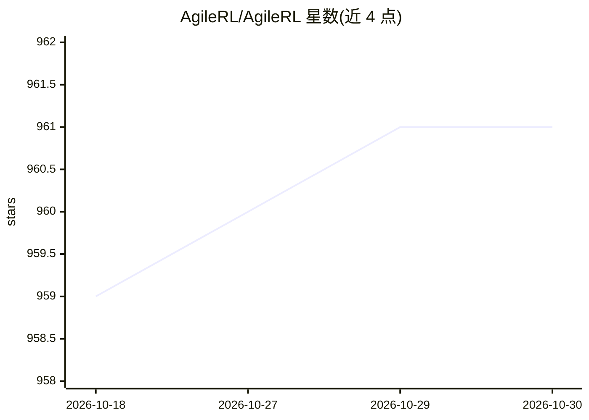

# AgileRL/AgileRL

⭐ 961 · Python · Apache-2.0 · 推送 2026-10-29 · [GitHub](https://github.com/AgileRL/AgileRL) · [官网](https://agilerl.com) · 组织维护

**面向开发者的 LLM 后训练与深度强化学习训练库**

AgileRL 是一个 Python 训练库，覆盖 LLM 后训练全流程：SFT、DPO 以及 GRPO/CISPO/GSPO/PPO/REINFORCE 等多轮 agentic RL 算法，支持 LoRA/QLoRA、FSDP2 并行、vLLM 快速 rollout，并内置进化式超参数优化（训练种群的超参在单次运行中演化）。同一库还支持经典深度 RL：单智能体、多智能体、离线 RL 与上下文老虎机，兼容 Gymnasium/PettingZoo 环境。附带 Arena CLI，可在托管 GPU 集群异步训练与部署检查点，训练配置以 YAML manifest 表达，也可本地 GPU 运行。

## 筛选速览

| 维度 | 判定 | 备注 |
|---|---|---|
| AI 角色 | `ai-ecosystem` | LLM/agent 周边工具 |
| 许可风险 | `permissive` | Apache-2.0 |
| 部署形态 | `library` | 以包/库形式分发 |
| 模型依赖 | local-ok | 支持本地模型 |
| 硬件要求 | — | 无带数字的原话,不猜 |
| 安装摩擦 | `low` | 无编译、无系统依赖或容器化 |
| 成熟度 | — | 结构信号不足 |

## 能力要点

- LLM 后训练算法覆盖 SFT/DPO/GRPO/CISPO/GSPO/PPO/REINFORCE
- 训练种群内置进化式超参数优化，无需预先跑大量调参试验
- 支持 LoRA/QLoRA、FSDP2 分片、vLLM rollout 与 colocate 部署
- 同一库覆盖经典深度 RL（单/多智能体、离线、老虎机）

## 适用场景

- 对开源权重 LLM 做指令微调、偏好对齐与多轮 agentic RL 训练
- 在 Gymnasium/PettingZoo 环境上做深度强化学习研究与实验
- 通过 Arena CLI 在托管 GPU 集群提交训练任务并部署最佳检查点

## 场景标签

`微调` `强化学习` · 领域:训练与推理

## 证据(README 行号)

> L13: AgileRL takes an open-weights LLM from supervised fine-tuning through preference tuning to multi-turn agentic RL, i
> L19: - **The whole pipeline.** SFT and DPO, then RL with GRPO, CISPO, GSPO, REINFORCE or PPO.
> L106: On-policy, off-policy, offline, multi-agent and contextual bandit algorithms, all with evolutionary HPO. Train a p

## 星数曲线

2026-10-18 959 → 2026-10-30 961（+2）

---
*卡片 v1 · prompt 1.4 · 生成 2026-10-21 · 置信度 high · 依据 README sha `28e3b0da8f21` · [字段定义](../../DATASET.md)*
