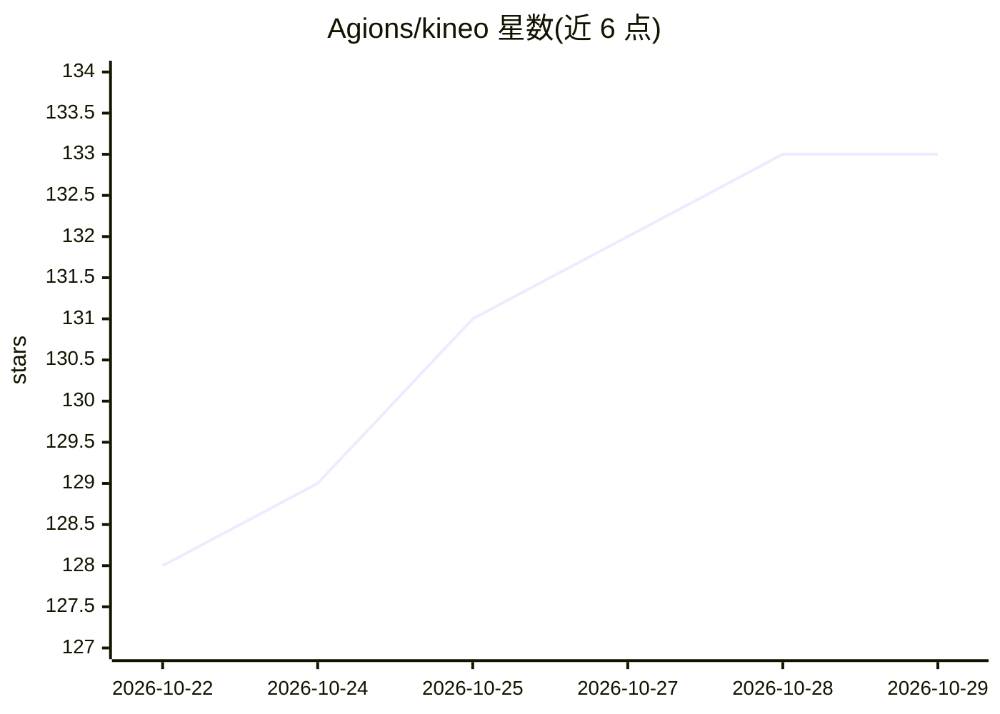

# Agions/kineo

⭐ 133 · TypeScript · MIT · 推送 2026-10-27 · [GitHub](https://github.com/Agions/kineo) · [官网](https://agions.github.io/kineo/) · 个人维护 · 中文 README

**桌面端 Multi-Agent 平台：把剧本/小说自动制作为 4K 漫剧视频**

基于 Tauri v2 + React 19 + Rust 的开源桌面应用，面向漫剧创作者、短视频博主与影视编导。采用 Hub-and-Spoke 架构与 ProjectBlackboard 共享黑板，由 MasterDirectorAgent 协调剧本识别、角色设计锁脸、分镜规划、TTS 配音、4K GPU 压制等专门智能体，将剧本文件(.txt/.md/.docx/.json)、小说文本或 AI 提示词推导为 4K 漫剧视频。支持 UI 注册自定义扩展 Agent，对接 13 家 AI 提供商；API Key 存于系统 Keyring，工程数据本地保存。README 版本号为 v0.0.1。

## 筛选速览

| 维度 | 判定 | 备注 |
|---|---|---|
| AI 角色 | `ai-native` | 本体是模型或模型工具 |
| 许可风险 | `permissive` | MIT |
| 部署形态 | `None` |  |
| 模型依赖 | locked-api |  |
| 硬件要求 | — | 无带数字的原话,不猜 |
| 安装摩擦 | `low` | 无编译、无系统依赖或容器化 |
| 成熟度 | — | 结构信号不足 |

## 能力要点

- Hub-and-Spoke 多智能体架构与 ProjectBlackboard 共享黑板
- 剧本/小说/AI 提示词三类输入自动解析到 4K 视频输出
- UI 一键注册自定义 Agent（名称、触发阶段、系统 Prompt）
- Apple VideoToolbox / NVIDIA NVENC GPU 4K 硬件加速压制

## 适用场景

- 把现成剧本或小说章节自动制成漫剧短视频
- 通过自定义扩展 Agent 在特定阶段介入创作流程
- 本地保存工程数据并批量生成配音分镜视频

## 场景标签

`多智能体` `视频生成` `语音合成` · 领域:Agent 开发

## 证据(README 行号)

> L20: 项目重构废除了原有的单向线性 SOP，采用全新的 **Hub-and-Spoke 多智能体协作架构** 与 **ProjectBlackboard 共享黑板模式**。支持现成剧本文件、小说文本与 AI 创作提示词三类素材输入，由主
> L31: |📐|**三大分类 AI 模型矩阵**|对接 13 大 AI 提供商，涵盖文字大模型（DeepSeek-V4/R1, Qwen 3.8-Max, 混元 Hy3 等）、生图与 4K 视频引擎|

## 星数曲线

2026-10-22 128 → 2026-10-29 133（+5）

---
*卡片 v1 · prompt 1.4 · 生成 2026-10-23 · 置信度 high · 依据 README sha `2f855ae07294` · [字段定义](../../DATASET.md)*
