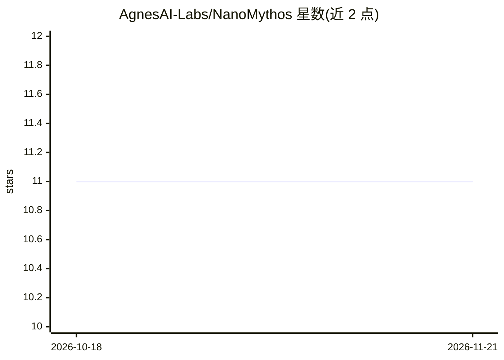

# AgnesAI-Labs/NanoMythos

⭐ 11 · Python · 推送 2026-05-27 · [GitHub](https://github.com/AgnesAI-Labs/NanoMythos) · 个人维护

**循环深度架构假设的小规模预训练验证技术报告**

一份技术报告：将 OpenMythos 的循环深度（recurrent-depth）思想移植到 nanowhale / DeepSeek-V4 风格的约 110M 小模型上，在 FineWeb-Edu 10K 数据集以 5,000 步预算进行对照预训练，用三个随机种子验证 T=1 单次循环对 held-out 困惑度的影响。报告给出基线与 T=1 的对比数据、GPT-2 外部参照、长度分箱分析与 T=2 边界检查，并包含训练管线的冒烟测试记录。面向语言模型架构研究者。

## 筛选速览

| 维度 | 判定 | 备注 |
|---|---|---|
| AI 角色 | `ai-knowledge` | 知识聚合/清单类 |
| 许可风险 | `none` | — |
| 部署形态 | `None` |  |
| 模型依赖 | — | README 未给出锁定关系 |
| 硬件要求 | — | 无带数字的原话,不猜 |
| 安装摩擦 | `low` | 无编译、无系统依赖或容器化 |
| 成熟度 | — | 结构信号不足 |

## 能力要点

- T=1 循环深度在 3/3 种子上降低 held-out PPL（均值 166.2→148.3）
- 以 nanowhale（DeepSeek-V4 风格 MoE）110M 模型为受控实验载体
- 含 GPT-2 124M 外部参照与按文本长度分箱的验证
- 记录 T=2 在当前配方下失效的边界检查与归因清单

## 适用场景

- 了解循环深度架构在小规模预训练中的实证表现
- 架构研究者设计受控的对照预训练实验
- 评估 T=1 是否值得作为更大规模试点方向

## 场景标签

`模型训练` `科研工具` · 领域:学习与行业

## 证据(README 行号)

> L3: # Recurrent Depth as a Testable Architecture Hypothesis: A NanoMythos Validation on FineWeb-Edu
> L81: > Under the same FineWeb-Edu 10K pretraining budget, does T=1 recurrent depth reduce held-out perplexity compared w
> L117: The headline metric is held-out perplexity:

## 星数曲线

2026-10-18 11 → 2026-11-21 11（+0）

---
*卡片 v1 · prompt 1.4 · 生成 2026-11-19 · 置信度 high · 依据 README sha `7c8d24511979` · [字段定义](../../DATASET.md)*
