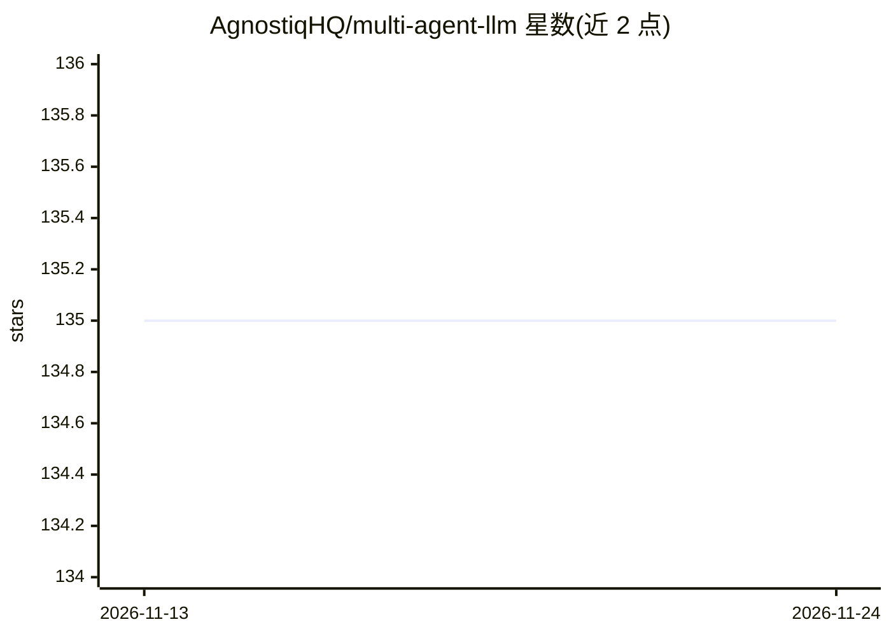

# AgnostiqHQ/multi-agent-llm

⭐ 135 · Python · AGPL-3.0 · 推送 2026-10-10 · [GitHub](https://github.com/AgnostiqHQ/multi-agent-llm) · 组织维护

**多智能体 LLM 推理方法库：AIoT/GIoT/AGoT 的精简实现**

Agnostiq 维护的 Python 库，提供多种多智能体 LLM 推理方法的精简实现：AIoT（自主迭代思考）、GIoT（引导式固定步数迭代）、AGoT（自适应思维图，用层间策略与递归自应用构建 DAG 分解复杂度）。模块化设计便于快速实验，README 提示不适用于生产环境。库内含 Iteration of Thought 与 Adaptive Graph of Thoughts 两篇论文的实验设置、数据集与结果，可复现实验。默认通过 OpenAI API 密钥调用模型。

## 筛选速览

| 维度 | 判定 | 备注 |
|---|---|---|
| AI 角色 | `ai-ecosystem` | LLM/agent 周边工具 |
| 许可风险 | `viral` | AGPL-3.0 |
| 部署形态 | `library` | 以包/库形式分发 |
| 模型依赖 | — | README 未给出锁定关系 |
| 硬件要求 | — | 无带数字的原话,不猜 |
| 安装摩擦 | `low` | 无编译、无系统依赖或容器化 |
| 成熟度 | — | 结构信号不足 |

## 能力要点

- AIoT：根据对话状态动态调整推理路径
- GIoT：按预定义步数强制迭代推理
- AGoT：层间策略与递归自应用构建 DAG 分解概念复杂度
- 附带 IoT 与 AGoT 论文的实验数据集与结果

## 适用场景

- 快速实验和对比多种多智能体 LLM 推理方法
- 复现 Iteration of Thought / AGoT 论文实验
- 在问答任务上测试迭代式推理提升效果

## 场景标签

`多智能体` · 领域:Agent 开发

## 证据(README 行号)

> L3: Welcome to the LLM based Multi-Agent repository! This repository provides a lean implementation of cutting-edge tech
> L33: This repository also contains the results for the paper Iteration of Thought and Adaptive Graph of Thoughts. You ca

## 星数曲线

2026-11-13 135 → 2026-11-24 135（+0）

---
*卡片 v1 · prompt 1.4 · 生成 2026-11-17 · 置信度 high · 依据 README sha `acfa43eed7ad` · [字段定义](../../DATASET.md)*
