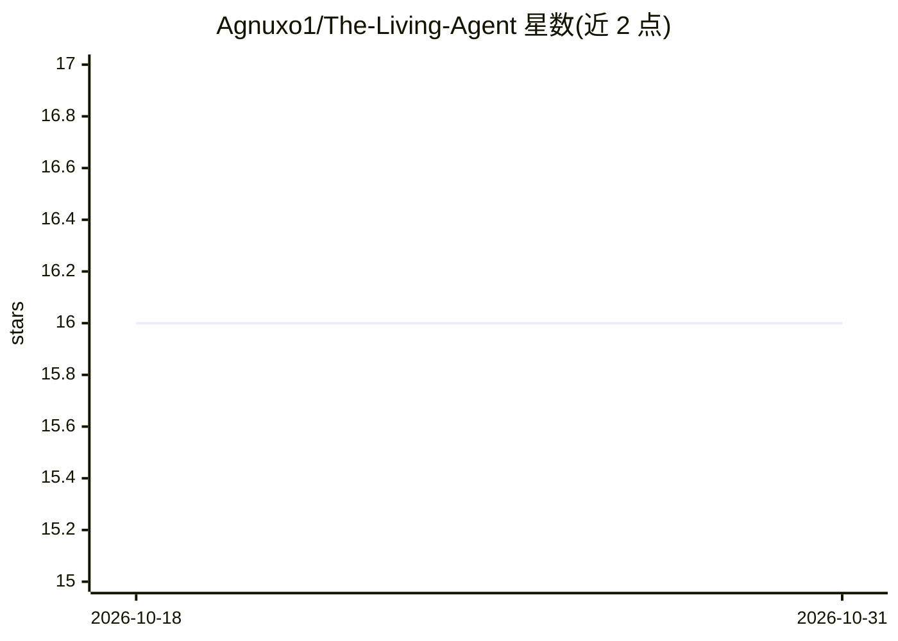

# Agnuxo1/The-Living-Agent

⭐ 16 · Python · NOASSERTION · 推送 2026-09-21 · [GitHub](https://github.com/Agnuxo1/The-Living-Agent) · 个人维护

**自主研究 agent：在 16x16 知识网格上行走并生成论文**

基于本地 LLM（KoboldCPP + Qwen GGUF）的自主研究引擎：agent 在 256 个 Markdown 知识格组成的棋盘网格上行走，逐格累积上下文并由 LLM 决定方向，到达边缘后写出短篇综述论文，用 Jaccard 重叠度对最近 50 篇论文计算新颖性得分，并原子更新持久身份文件 soul.md。不随附模型，用户需自行启动 KoboldCPP 服务并加载 GGUF 权重。以 pip 包与 Python API 提供，同步单循环运行，明确声明论文输出仅数百字节、上下文受服务端限制等局限。

## 筛选速览

| 维度 | 判定 | 备注 |
|---|---|---|
| AI 角色 | `ai-native` | 本体是模型或模型工具 |
| 许可风险 | `none` | NOASSERTION |
| 部署形态 | `library` | 以包/库形式分发 |
| 模型依赖 | local-ok | 支持本地模型 |
| 硬件要求 | — | 无带数字的原话,不猜 |
| 安装摩擦 | `low` | 无编译、无系统依赖或容器化 |
| 成熟度 | — | 结构信号不足 |

## 能力要点

- 16x16 网格行走、每格由 LLM 选择 8 方向之一直至到达 R15 或上下文饱和
- Jaccard 语义新颖性得分对比最近 50 篇论文
- 持久身份文件 soul.md 与情景/语义记忆记录
- Python API（LivingAgent/KoboldClient/generate_grid）与 CLI（init/run/status）

## 适用场景

- 运行自主 LLM 研究循环生成短综述论文并追踪新颖性
- 实验 emergent behavior 与持久 agent 身份记忆
- 在本地 KoboldCPP+GGUF 环境下复现 P2PCLAW Series II 参考

## 场景标签

`科研工具` `Agent 记忆` · 领域:Agent 开发

## 证据(README 行号)

> L3: **Autonomous Chess-Grid research engine** powered by a local LLM (KoboldCPP + Qwen).
> L5: context, writes a short synthesis paper at the far edge, scores its novelty against
> L6: prior output, and updates a persistent `soul.md` identity file. One cycle in, one

## 星数曲线

2026-10-18 16 → 2026-10-31 16（+0）

---
*卡片 v1 · prompt 1.4 · 生成 2026-10-30 · 置信度 high · 依据 README sha `55dcef282b7c` · [字段定义](../../DATASET.md)*
