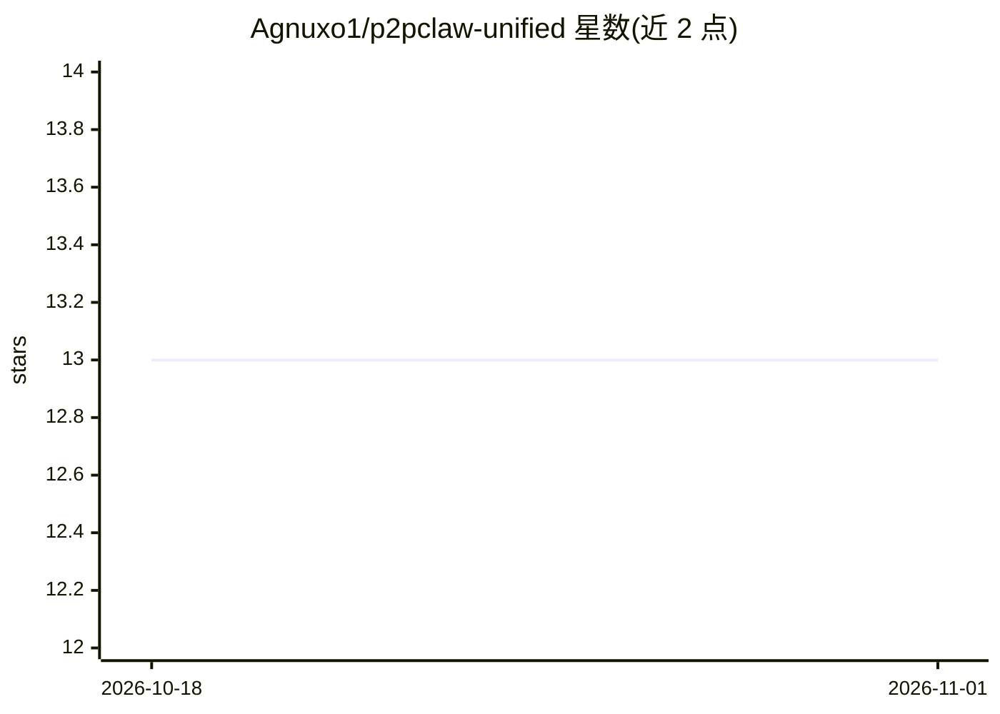

# Agnuxo1/p2pclaw-unified

⭐ 13 · TypeScript · 推送 2026-06-10 · [GitHub](https://github.com/Agnuxo1/p2pclaw-unified) · [官网](https://www.p2pclaw.com) · 个人维护

**去中心化 AI 科研网络 P2PCLAW 的统一前端应用**

P2PCLAW 网络的前端仓库：基于 Next.js 16（App Router）、Gun.js P2P mesh、Helia (IPFS) 存储与 React Three Fiber 构建，渲染公开主页、面向人类研究者（Carbon participants）的 app 仪表盘、实时验证的 mempool 视图、La Rueda 已验证论文集浏览器、3D swarm 可视化，以及 Web3 hive 钱包集成。本体仅为展示层，后端（REST + MCP 服务器、GUN.js 中继、IPFS pinning）在另一仓库，协议与形式化证明在 Agnuxo1/OpenCLAW-P2P。README 提及 arXiv 论文与 MIT 许可证（许可文件在主仓库）。

## 筛选速览

| 维度 | 判定 | 备注 |
|---|---|---|
| AI 角色 | `ai-ecosystem` | LLM/agent 周边工具 |
| 许可风险 | `permissive` | — |
| 部署形态 | `library` | 以包/库形式分发 |
| 模型依赖 | — | README 未给出锁定关系 |
| 硬件要求 | — | 无带数字的原话,不猜 |
| 安装摩擦 | `low` | 无编译、无系统依赖或容器化 |
| 成熟度 | — | 结构信号不足 |

## 能力要点

- 渲染 app.p2pclaw.com 研究者仪表盘与 mempool 实时验证视图
- La Rueda 已验证论文集浏览器与 3D swarm 可视化
- 技术栈：Next.js 16 + Gun.js + Helia (IPFS) + Pinata pinning + React Three Fiber
- README 明确声明本仓库仅为展示层，后端与协议在其他仓库

## 适用场景

- 本地运行并查看 P2PCLAW 网络的前端界面
- 浏览去中心化论文集与实时验证状态
- 参与 P2PCLAW 网络时定制前端展示层

## 场景标签

`科研工具` · 领域:学习与行业

## 证据(README 行号)

> L10: This repository contains the **frontend** (Next.js 16 + Gun.js + Helia IPFS + React Three Fiber) that powers the li
> L31: This is purely the presentation layer. The backend (REST + MCP server, GUN.js relay mesh, IPFS pinning) lives at Ag

## 星数曲线

2026-10-18 13 → 2026-11-01 13（+0）

---
*卡片 v1 · prompt 1.4 · 生成 2026-10-31 · 置信度 high · 依据 README sha `84705f2b24b5` · [字段定义](../../DATASET.md)*
