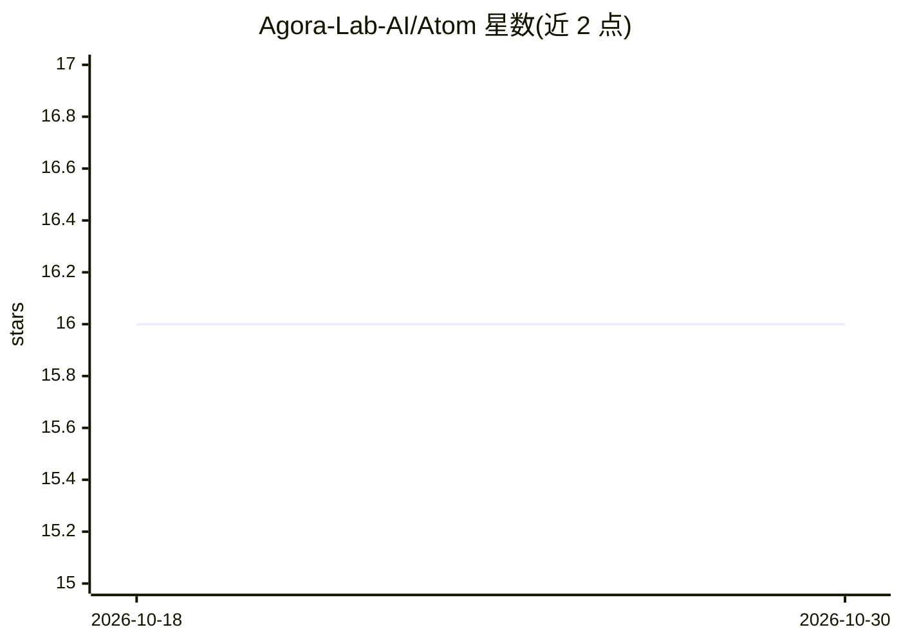

# Agora-Lab-AI/Atom

⭐ 16 · Python · MIT · 推送 2026-10-26 · [GitHub](https://github.com/Agora-Lab-AI/Atom) · [官网](https://discord.gg/GYbXvDGevY) · 组织维护

**面向精确函数调用微调的 LLM 模型套件**

Agora-Lab-AI 维护的微调 LLM 套件，目标是原子级精确的函数调用能力。提供超 2000 万样本规模的函数调用数据集，首个模型 Atom-Z-Tiny 基于 Zephyr 在 10 万样本上训练，视觉函数调用为规划中功能。以 pip 包 atom-torch 安装，通过 transformers 加载模型；训练环节使用 accelerate 配合 DeepSpeed ZeRO-3，并引用 YaRN 上下文窗口扩展工作。

## 筛选速览

| 维度 | 判定 | 备注 |
|---|---|---|
| AI 角色 | `ai-native` | 本体是模型或模型工具 |
| 许可风险 | `permissive` | MIT |
| 部署形态 | `library` | 以包/库形式分发 |
| 模型依赖 | — | README 未给出锁定关系 |
| 硬件要求 | — | 无带数字的原话,不猜 |
| 安装摩擦 | `low` | 无编译、无系统依赖或容器化 |
| 成熟度 | `idea` | |

## 能力要点

- 超 20M 样本的函数调用数据集
- 首个模型 Atom-Z-Tiny（Zephyr 基于 100k 样本训练）
- 提供 pip 包 atom-torch 与 transformers 加载用法
- 训练脚本使用 DeepSpeed ZeRO-3 加速

## 适用场景

- 需要一个专做函数调用的开源 LLM 做工具调用任务
- 复用大规模函数调用数据集做微调
- 参考 DeepSpeed ZeRO-3 微调流程训练自己的模型

## 场景标签

`微调` · 领域:训练与推理

## 证据(README 行号)

> L4: a suite of finetuned LLMs for atomically precise function calling 🧪
> L6: ✅ Massive function calling dataset of over 20M samples.

## 星数曲线

2026-10-18 16 → 2026-10-30 16（+0）

---
*卡片 v1 · prompt 1.4 · 生成 2026-10-30 · 置信度 high · 依据 README sha `64d72bfeb3a5` · [字段定义](../../DATASET.md)*
