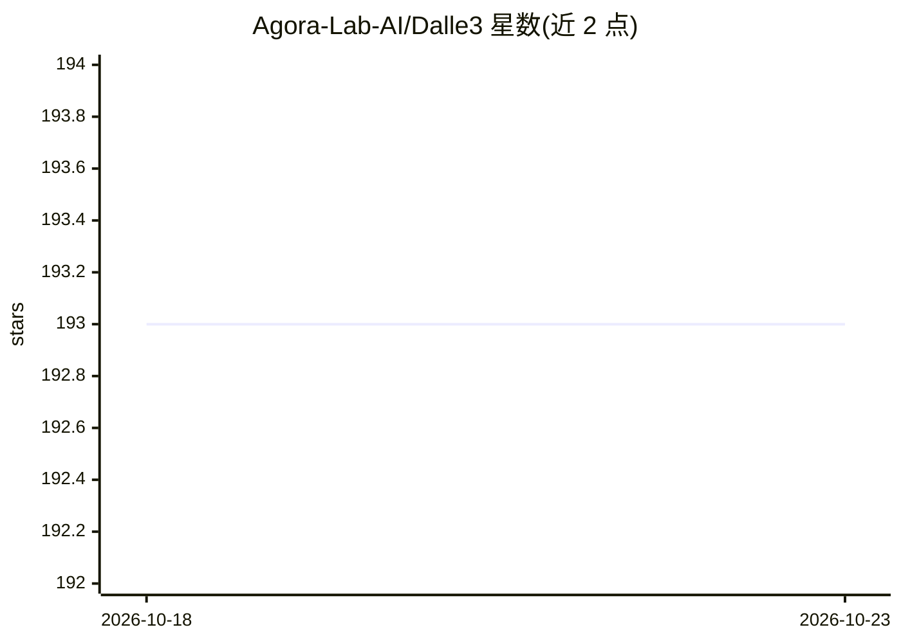

# Agora-Lab-AI/Dalle3

⭐ 193 · Python · MIT · 推送 2026-10-09 · [GitHub](https://github.com/Agora-Lab-AI/Dalle3) · [官网](https://discord.gg/qUtxnK2NMf) · 组织维护

**通过 Bing Image Creator 生成图像的 DALL-E 3 非官方 API**

Python 库形式封装 DALL-E 3 非官方 API：使用 Selenium WebDriver 打开 Bing Image Creator 页面，需用户提供浏览器登录 cookie（_U 值）绕过自动化检测，按文本 query 生成图像并自动下载到指定文件夹。核心类 Dalle 提供 create/get_urls/download/run 等方法，run 串联全流程；附带实时日志。README 声明代码按原样提供，与源网站无关联。MIT 许可。

## 筛选速览

| 维度 | 判定 | 备注 |
|---|---|---|
| AI 角色 | `ai-ecosystem` | LLM/agent 周边工具 |
| 许可风险 | `permissive` | MIT |
| 部署形态 | `library` | 以包/库形式分发 |
| 模型依赖 | — | README 未给出锁定关系 |
| 硬件要求 | — | 无带数字的原话,不猜 |
| 安装摩擦 | `low` | 无编译、无系统依赖或容器化 |
| 成熟度 | — | 结构信号不足 |

## 能力要点

- pip 安装，数行代码按 query 生成并下载图像
- 通过 cookie 绕过自动化检测访问 Bing Image Creator
- run 方法一键完成生成、URL 提取与下载全流程
- 附实时日志输出与自动创建保存目录

## 适用场景

- 在 Python 项目中调用 DALL-E 3 生成图像
- 按自定义 prompt 批量生成并保存图片
- 想用已有 Bing 账号 cookie 试用图像生成 API 的开发者

## 场景标签

`图像生成` · 领域:内容生成

## 证据(README 行号)

> L38: This library houses the DALL-E 3 Unofficial API, providing tools to download images based on queries. The `Dalle` c
> L42: - **DALL-E 3 API Interaction:** The `Dalle` class provides an interface to interact with the DALL-E 3 Unofficial AP
> L66: - `create(query: str)`: Opens the Bing Image Creator (DALL-E 3) and adds a cookie to interact with the API.

## 星数曲线

2026-10-18 193 → 2026-10-23 193（+0）

---
*卡片 v1 · prompt 1.4 · 生成 2026-10-22 · 置信度 mid · 依据 README sha `956b76c0d5c3` · [字段定义](../../DATASET.md)*
