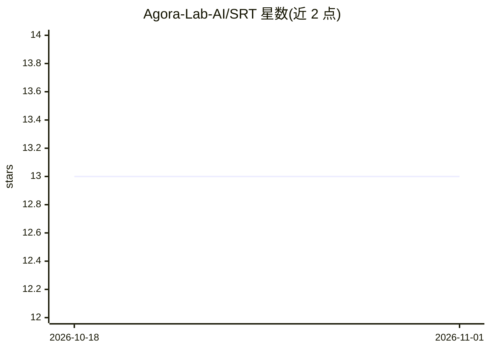

# Agora-Lab-AI/SRT

⭐ 13 · Python · MIT · 推送 2026-10-26 · [GitHub](https://github.com/Agora-Lab-AI/SRT) · [官网](https://agoralab.xyz) · 组织维护

**SRT 手术机器人模仿学习模型的社区开源实现**

Surgical Robot Transformer (SRT) 论文的非官方社区 PyTorch 实现：SRT 以内窥镜与腕部相机图像为输入，经 Transformer 输出双臂末端位姿（每臂 10 维向量），通过模仿学习执行组织提起、 needle 拾取交接、打结等手术任务。本仓库提供 pip 安装包与推理用法示例及模型架构图，训练逻辑标注为进行中；README 还整理了论文所用数据集（dVRK 平台采集）与实现细节摘录。给机器人学习研究者使用。

## 筛选速览

| 维度 | 判定 | 备注 |
|---|---|---|
| AI 角色 | `ai-native` | 本体是模型或模型工具 |
| 许可风险 | `permissive` | MIT |
| 部署形态 | `library` | 以包/库形式分发 |
| 模型依赖 | — | README 未给出锁定关系 |
| 硬件要求 | — | 无带数字的原话,不猜 |
| 安装摩擦 | `low` | 无编译、无系统依赖或容器化 |
| 成熟度 | `idea` | |

## 能力要点

- 论文模型的非官方社区 PyTorch 实现（pip 可装）
- 四路相机图像输入，输出双臂末端位姿 20 维向量（6D 旋转表示）
- 整理论文三个数据集（Tissue Lift / Needle Pickup / Knot Tying）与实现细节
- 训练逻辑与测试标注为未完成（Todo）

## 适用场景

- 复现 SRT 论文的手术任务模仿学习策略
- 在 dVRK 类平台上做手术机器人策略研究
- 参考论文实现细节做类似多臂机器人模型开发

## 场景标签

`模型训练` · 领域:训练与推理

## 证据(README 行号)

> L5: An open-source non-official community implementation of the model from the paper: Surgical Robot Transformer (SRT): 
> L10: pip3 install srt-torch

## 星数曲线

2026-10-18 13 → 2026-11-01 13（+0）

---
*卡片 v1 · prompt 1.4 · 生成 2026-10-31 · 置信度 high · 依据 README sha `753e10509938` · [字段定义](../../DATASET.md)*
