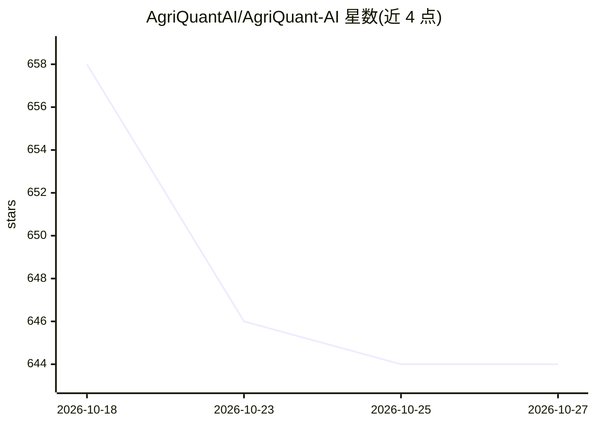

# AgriQuantAI/AgriQuant-AI

⭐ 644 · Python · 推送 2026-05-26 · [GitHub](https://github.com/AgriQuantAI/AgriQuant-AI) · [官网](https://agriquant.ai) · 组织维护

**预测六大农产品期货价格波动的 AI 天气情报系统**

面向量化交易场景的农业商品天气情报系统：持续接入 NOAA 天气预报、多光谱卫星影像（NDVI、热力、水汽通量）与市场数据，对照 40 年天气驱动的价格历史库，在官方 USDA 报告发布前生成概率性价格影响信号，覆盖橙汁、咖啡、可可、糖、玉米、小麦六个市场。分析管线基于 Claude Sonnet，另有 4 模型 ML 集成与 PyTorch LSTM 预测器；提供回测引擎（2023–2025 回测，2.5 倍杠杆）、风险管理模块与 FastAPI 透明端点。README 声明回测假设完美成交、无滑点且含事后信号构建。

## 筛选速览

| 维度 | 判定 | 备注 |
|---|---|---|
| AI 角色 | `ai-native` | 本体是模型或模型工具 |
| 许可风险 | `none` | — |
| 部署形态 | `library` | 以包/库形式分发 |
| 模型依赖 | locked-api |  |
| 硬件要求 | — | 无带数字的原话,不猜 |
| 安装摩擦 | `low` | 无编译、无系统依赖或容器化 |
| 成熟度 | — | 结构信号不足 |

## 能力要点

- NOAA + 卫星数据 + 40 年价格历史的信号生成管线
- Claude Sonnet 分析管线与 4 模型 ML 集成、LSTM 预测器并存
- 覆盖 ICE/CME 六个农产品期货市场
- 提供回测引擎、风险管理与 FastAPI 端点

## 适用场景

- 跟踪产区政府报告发布前的天气驱动价格信号
- 对六个农产品期货做历史回测与策略验证
- 结合卫星 NDVI 与干旱指数辅助交易决策

## 场景标签

`金融量化` · 领域:学习与行业

## 证据(README 行号)

> L11: AgriQuant AI analyzes satellite weather data and 40 years of price patterns to predict agricultural commodity moves
> L15: AgriQuant AI monitors weather events across six agricultural commodity markets and generates probabilistic price im

## 星数曲线

2026-10-18 658 → 2026-10-27 644（-14）

---
*卡片 v1 · prompt 1.4 · 生成 2026-10-21 · 置信度 high · 依据 README sha `c0cce55e2cbc` · [字段定义](../../DATASET.md)*
