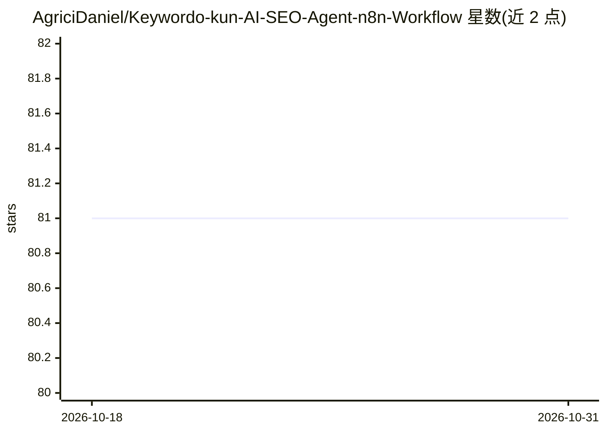

# AgriciDaniel/Keywordo-kun-AI-SEO-Agent-n8n-Workflow

⭐ 81 · MIT · 推送 2026-04-10 · [GitHub](https://github.com/AgriciDaniel/Keywordo-kun-AI-SEO-Agent-n8n-Workflow) · [官网](https://agricidaniel.com/blog/n8n-seo-content-system) · 个人维护

**面向营销人员的 n8n 竞品分析与 SEO 博客自动写作 AI Agent 工作流**

基于 n8n 自动化平台构建的 AI agent 完整工作流仓库：使用 Google Gemini（2.5 Pro & Flash）做推理与内容生成，DataForSEO 提供 SERP 数据、关键词与竞品指标，Firecrawl 抓取网站内容，v0.dev 部署对话前端。仓库提供两个可导入的 n8n 工作流 JSON（Agent 主流程与工具集）及聊天界面 zip。给营销人员、代理机构与 SEO 从业者使用。需自备 n8n、v0.dev、Google AI Studio、DataForSEO、Firecrawl 五个服务的账号与 API key，无本地运行时依赖。

## 筛选速览

| 维度 | 判定 | 备注 |
|---|---|---|
| AI 角色 | `ai-native` | 本体是模型或模型工具 |
| 许可风险 | `permissive` | MIT |
| 部署形态 | `None` |  |
| 模型依赖 | — | README 未给出锁定关系 |
| 硬件要求 | — | 无带数字的原话,不猜 |
| 安装摩擦 | `low` | 无编译、无系统依赖或容器化 |
| 成熟度 | — | 结构信号不足 |

## 能力要点

- 两个 n8n 工作流 JSON：Agent 主流程 + 独立工具集（关键词建议、SERP 分析等）
- Gemini 2.5 Pro & Flash 驱动推理、分析与长文生成
- v0.dev 对话前端 zip 可直接导入部署
- DataForSEO 提供 SERP 数据与竞品指标，Firecrawl 网站抓取

## 适用场景

- 我想自动化竞品分析与关键词缺口研究
- 我想让 AI agent 自动生成 SEO 长文博客
- 我想搭建一个用对话驱动的营销研究 agent

## 场景标签

`工作流自动化` `AI 写作` · 领域:效率与自动化

## 证据(README 行号)

> L6: This repository contains the complete workflow for **Keywordo-kun**, an AI agent specialized in competitor analysis,
> L16: * **Google Gemini (2.5 Pro & Flash):** Powers the agent's core reasoning, analysis, and content generation.

## 星数曲线

2026-10-18 81 → 2026-10-31 81（+0）

---
*卡片 v1 · prompt 1.4 · 生成 2026-10-24 · 置信度 high · 依据 README sha `7095140c446f` · [字段定义](../../DATASET.md)*
