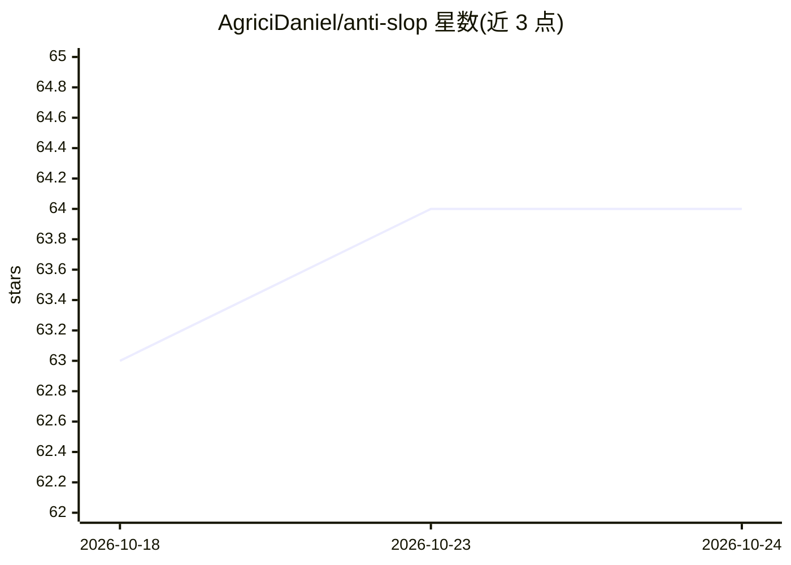

# AgriciDaniel/anti-slop

⭐ 64 · Python · Apache-2.0 · 推送 2026-09-11 · [GitHub](https://github.com/AgriciDaniel/anti-slop) · [官网](https://www.skool.com/ai-marketing-hub) · 个人维护

**检测并修复 AI 辅助文本/代码中实质缺陷的工具集，只报缺陷不判作者**

由 Claude Code 插件（5 个技能、2 个子代理、1 个 PostToolUse 钩子）、Obsidian 知识库（62 篇笔记、43 条来源账本）与六个纯标准库 Python 确定性扫描器组成。检测采用三层机制：确定性扫描器、需产出可核查工件的结构化测试（删除/反转/陌生人/引文溯源/承重测试）、以及永不单独判失败的证据分级信号；明确不做 AI 作者判定，也拒绝用 LLM 评审做裁决。安装为 git clone 后符号链接到 ~/.claude/skills，扫描器离线默认只查形状与校验和。

## 筛选速览

| 维度 | 判定 | 备注 |
|---|---|---|
| AI 角色 | `ai-ecosystem` | LLM/agent 周边工具 |
| 许可风险 | `permissive` | Apache-2.0 |
| 部署形态 | `None` |  |
| 模型依赖 | — | README 未给出锁定关系 |
| 硬件要求 | — | 无带数字的原话,不猜 |
| 安装摩擦 | `low` | 无编译、无系统依赖或容器化 |
| 成熟度 | — | 结构信号不足 |

## 能力要点

- 三层检测：确定性扫描器、结构化测试、证据分级信号（后者永不单独判失败）
- 五个结构化测试（删除/反转/陌生人/引文/承重）均须产出可人工核查的工件
- 六个纯 Python 标准库确定性扫描器，无第三方依赖
- 43 条来源账本记录证据等级、利益冲突与八处领域流传数字更正

## 适用场景

- 审查 AI 辅助写作的文档与文案中的实质缺陷
- 校验引文、链接与依赖包是否真实可解析
- 在 Claude Code 工作流中自动复查 AI 生成的代码与文档

## 场景标签

`AI 写作` `代码审查` · 领域:编码与开发

## 证据(README 行号)

> L99:   anti-slop-plugin/     Claude Code plugin: 5 skills, 2 subagents, marker references,
> L122: |`scripts/`|Six deterministic scanners plus two adapter lanes|
> L3: Anti Slop: find and repair substance defects in AI-assisted prose, code, docs, and agent output. Reports defects, ne

## 星数曲线

2026-10-18 63 → 2026-10-24 64（+1）

---
*卡片 v1 · prompt 1.4 · 生成 2026-10-24 · 置信度 high · 依据 README sha `b1b65a08a5c6` · [字段定义](../../DATASET.md)*
