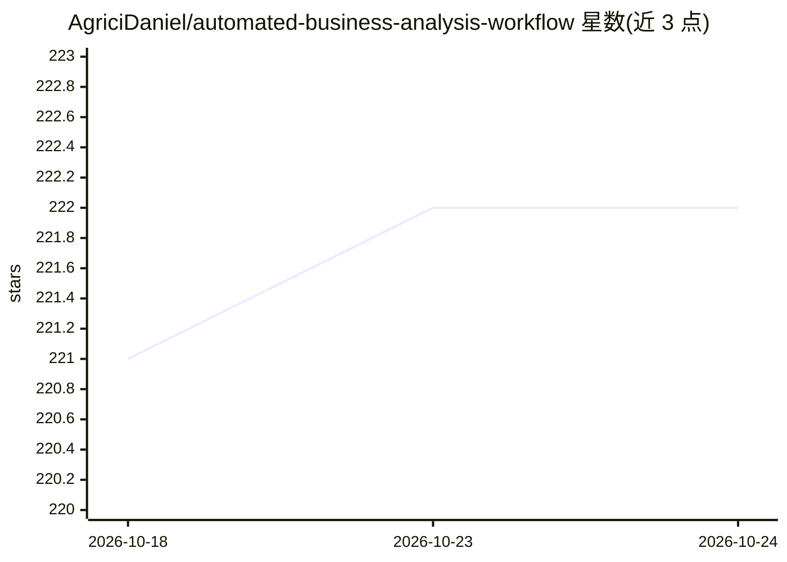

# AgriciDaniel/automated-business-analysis-workflow

⭐ 222 · MIT · 推送 2026-04-10 · [GitHub](https://github.com/AgriciDaniel/automated-business-analysis-workflow) · [官网](https://www.skool.com/ai-marketing-hub) · 个人维护

**输入网址自动生成商业分析报告的 n8n 工作流**

一个 n8n 自动化工作流（免费版）：用户提交一个 URL，工作流通过 Firecrawl 抓取网站内容，由 Perplexity 与 Google Gemini 的 AI 分析抓取数据，生成包含公司概况、目标人群画像、品牌与 UVP、客户旅程和 E-E-A-T 信号分析的商业报告，以 Google Doc 和 PDF 格式经 Gmail 送达。面向代理机构、自由职业者和顾问。免费版不含关键词研究组件（Pro 版使用 DataForSEO）。使用需自备 n8n 账号（云或自托管）、Firecrawl/Perplexity/Gemini API key 及 Google 凭据。

## 筛选速览

| 维度 | 判定 | 备注 |
|---|---|---|
| AI 角色 | `ai-native` | 本体是模型或模型工具 |
| 许可风险 | `permissive` | MIT |
| 部署形态 | `None` |  |
| 模型依赖 | — | README 未给出锁定关系 |
| 硬件要求 | — | 无带数字的原话,不猜 |
| 安装摩擦 | `low` | 无编译、无系统依赖或容器化 |
| 成熟度 | — | 结构信号不足 |

## 能力要点

- 提交一个 URL 即自动抓取并生成商业分析报告
- AI 分析产出公司概况/人群画像/UVP/客户旅程/E-E-A-T 等结构化内容
- 报告以 Google Doc 模板生成 PDF 并经 Gmail 送达

## 适用场景

- 代理机构做客户调研前的快速背景分析
- 自由职业者为潜在客户生成商业分析报告
- 竞争分析时批量了解目标公司基本情况

## 场景标签

`工作流自动化` `网页抓取` `数据分析` · 领域:效率与自动化

## 证据(README 行号)

> L5: This is the free version of the automated business intelligence system that scrapes any website, extracts key data, 
> L31: * **Perplexity & Google Gemini:** AI agents analyze the scraped data to extract and structure the business intellig

## 星数曲线

2026-10-18 221 → 2026-10-24 222（+1）

---
*卡片 v1 · prompt 1.4 · 生成 2026-10-22 · 置信度 high · 依据 README sha `9e83771548da` · [字段定义](../../DATASET.md)*
