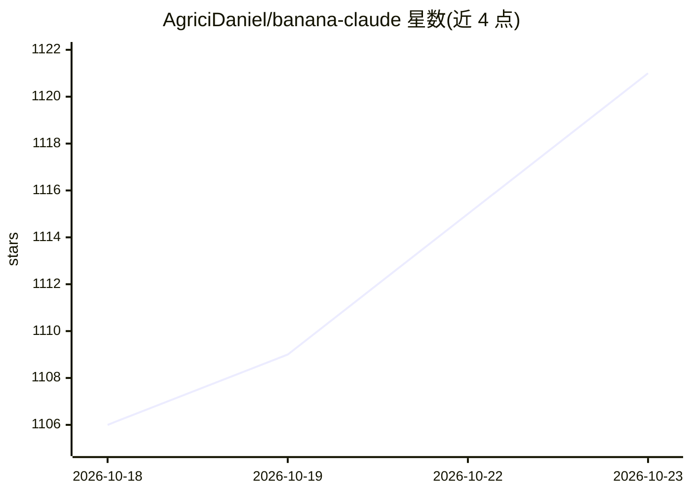

# AgriciDaniel/banana-claude

⭐ 1,121 · Python · MIT · 推送 2026-10-21 · [GitHub](https://github.com/AgriciDaniel/banana-claude) · [官网](skool.com/ai-marketing-hub-pro) · 个人维护

**Claude Code 插件：在会话中规划、生成与审阅 Gemini 图像**

运行于 Claude Code 的图像生成技能插件（v3.0.0，MIT）：将自然语言创意请求转为可视化的 Gemini 图像工作流，先离线生成计划（展示 prompt、模型、数据设置、输出位置与费用估计），经用户批准后才发起付费请求。功能包括生成、编辑、迭代、三路 prompt 对比、审阅与本地排版；路由于 Nano Banana 2 Lite / 2 / Pro 模型。要求 Claude Code 2.1.199+、Python 3.11+ 与计费启用的 Gemini API key；插件默认安装后处于禁用状态，一次批准仅授权一次提供商调用。

## 筛选速览

| 维度 | 判定 | 备注 |
|---|---|---|
| AI 角色 | `ai-native` | 本体是模型或模型工具 |
| 许可风险 | `permissive` | MIT |
| 部署形态 | `None` |  |
| 模型依赖 | — | README 未给出锁定关系 |
| 硬件要求 | — | 无带数字的原话,不猜 |
| 安装摩擦 | `low` | 无编译、无系统依赖或容器化 |
| 成熟度 | — | 结构信号不足 |

## 能力要点

- 先计划后批准：付费请求前展示 prompt/模型/费用估计
- 生成、编辑、迭代、三路对比与本地排版能力
- 路由 Nano Banana 2 Lite / Nano Banana 2 / Nano Banana Pro
- API key 不进入命令、URL、元数据；输出附带隐私元数据 sidecar

## 适用场景

- 在 Claude Code 会话中生成和编辑营销图、封面、概念图等素材
- 以可审阅的预算计划控制付费图像生成
- 对比多个 prompt 与模型路由后择优出图

## 场景标签

`图像生成` · 领域:内容生成

## 证据(README 行号)

> L9:  Create, edit, compare, and review Gemini images from Claude Code.
> L15: Banana Claude turns a plain-language creative request into a planned and
> L66: Banana Claude routes across Google's current Nano Banana 2 Lite, Nano Banana 2,

## 星数曲线

2026-10-18 1,106 → 2026-10-23 1,121（+15）

---
*卡片 v1 · prompt 1.4 · 生成 2026-10-21 · 置信度 high · 依据 README sha `d19a42f158e8` · [字段定义](../../DATASET.md)*
