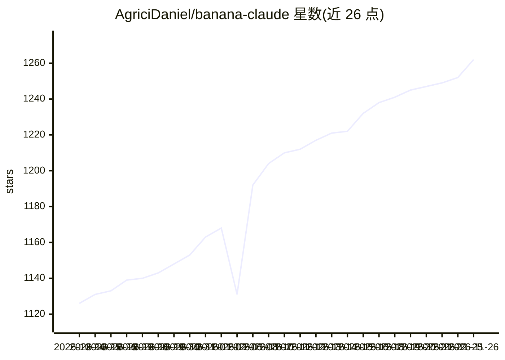

# AgriciDaniel/banana-claude

⭐ 1,262 · Python · MIT · 推送 2026-11-20 · [GitHub](https://github.com/AgriciDaniel/banana-claude) · [官网](skool.com/ai-marketing-hub-pro) · 个人维护

**Claude Code 插件：以 Gemini 生成与编辑图像**

一个 Claude Code 插件，把自然语言创意请求转为可审阅的 Gemini 图像工作流，覆盖生成、编辑、迭代、多提示多模型对比与成图审查。关键机制：先离线生成计划（prompt、模型、隐私设置、估算），经用户批准后才发起付费请求，一次批准仅授权一次调用；输出附隐私元数据 sidecar。要求 Claude Code 2.1.199+、Python 3.11+ 与已启用的 Gemini API key；不支持原生 Windows，需用 WSL。

## 筛选速览

| 维度 | 判定 | 备注 |
|---|---|---|
| AI 角色 | `ai-native` | 本体是模型或模型工具 |
| 许可风险 | `permissive` | MIT |
| 部署形态 | `None` |  |
| 模型依赖 | — | README 未给出锁定关系 |
| 硬件要求 | — | 无带数字的原话,不猜 |
| 安装摩擦 | `low` | 无编译、无系统依赖或容器化 |
| 成熟度 | — | 结构信号不足 |

## 能力要点

- 先计划后付费：执行前展示 prompt、模型、数据设置与估算并要求批准
- 跨 Nano Banana 2.1/2 Lite/Pro 多模型路由，最多 3 提示 × 3 路由对比
- 生成、编辑、迭代、本地排版（字体/Logo/文案）与成图审查六类工作流
- API key 不进入命令、URL、元数据与公共 CI

## 适用场景

- 在 Claude Code 中生成营销视觉、封面、产品场景等图像
- 对已有图像做保护身份与几何的单点修改
- 在多个模型路由间对比提示效果
- 为成图做文案、构图、版权与来源审查

## 场景标签

`图像生成` · 领域:内容生成

## 证据(README 行号)

> L9:  Create, edit, compare, and review Gemini images from Claude Code.
> L15: Banana Claude turns a plain-language creative request into a planned and
> L42: Banana Claude plans offline first. Review the exact plan, then approve the paid

## 星数曲线

2026-10-24 1,126 → 2026-11-26 1,262（+136）

---
*卡片 v1 · prompt 1.4 · 生成 2026-11-23 · 置信度 high · 依据 README sha `2e3e4e2f2418` · [字段定义](../../DATASET.md)*
