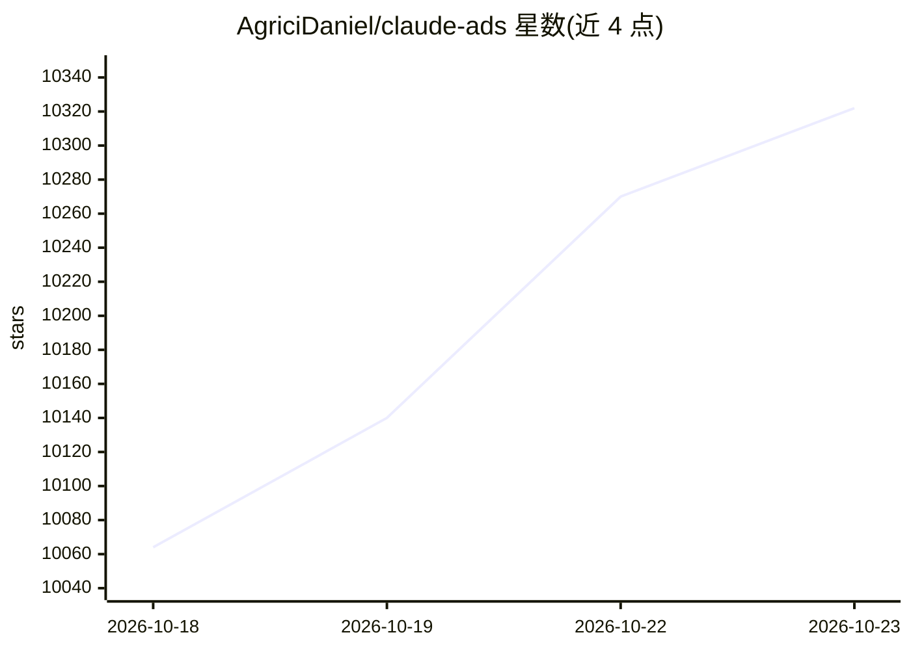

# AgriciDaniel/claude-ads

⭐ 10,322 · Python · MIT · 推送 2026-10-17 · [GitHub](https://github.com/AgriciDaniel/claude-ads) · [官网](skool.com/ai-marketing-hub-pro) · 个人维护

**面向广告运营者的 Claude Code 审计技能：跨 12 个广告平台出具证据化审计**

开源的 Claude Code 技能（skill），面向代理公司、顾问与内部营销团队。用户提交广告账户导出数据（CSV/JSON、截图或摘要），技能通过 /ads 命令集生成基于证据的账户审计、投放计划、素材简报与监控报告，覆盖 Google、Meta、YouTube 等 12 个广告平台。核心机制：所有检查结果为 pass/fail/unknown/not_applicable 四态、默认只读不改账户、输出带版本号的 JSON 报告、账户变更需通过 mutation gate 并留审批与回滚记录。项目自声明为 development candidate，未达到发布就绪状态；除 Claude Code 外的其他运行时（Codex/Gemini 等）标注为 EXPERIMENTAL。

## 筛选速览

| 维度 | 判定 | 备注 |
|---|---|---|
| AI 角色 | `ai-native` | 本体是模型或模型工具 |
| 许可风险 | `permissive` | MIT |
| 部署形态 | `library` | 以包/库形式分发 |
| 模型依赖 | locked-api |  |
| 硬件要求 | — | 无带数字的原话,不猜 |
| 安装摩擦 | `low` | 无编译、无系统依赖或容器化 |
| 成熟度 | `idea` | |

## 能力要点

- 覆盖 12 个广告平台的审计/计划/创建/监控/实验命令集
- pass/fail/unknown/not_applicable 四态检查，缺失数据标记为 unknown 而非猜测
- 默认只读；账户变更需能力门控、diff、审批上限、幂等键与回滚窗口
- 输出带版本的 JSON run bundle，可渲染为 Markdown/HTML/PDF

## 适用场景

- 导入广告账户数据后跑 /ads audit 获取逐项证据的审计报告
- 代理或营销团队决定各渠道预算与投放计划
- 持续监控投放节奏、追踪、素材疲劳与政策合规

## 场景标签

 · 领域:广告营销/运营工具

## 证据(README 行号)

> L5: Claude Ads is a free, open source skill for Claude Code. Give it your ad account data and it tells you what is worki
> L19: 1. Install (see Installation): `/plugin marketplace add agricidaniel/claude-ads`, then `/plugin install claude-ads@
> L83: Claude Code is the canonical runtime. Codex, Gemini, Cursor, Windsurf, Goose,

## 星数曲线

2026-10-18 10,064 → 2026-10-23 10,322（+258）

---
*卡片 v1 · prompt 1.4 · 生成 2026-10-20 · 置信度 mid · 依据 README sha `ec17ed7ad508` · [字段定义](../../DATASET.md)*
